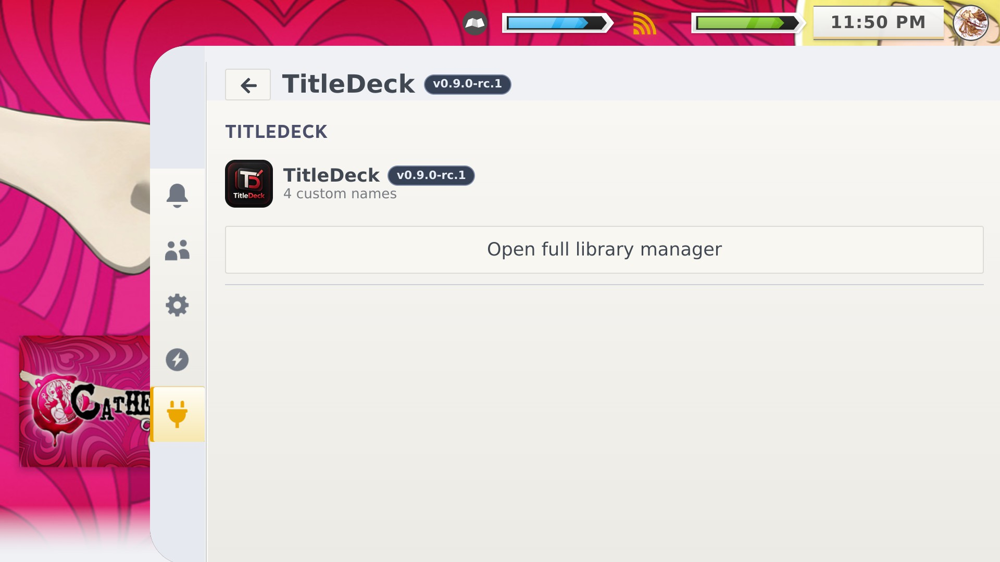
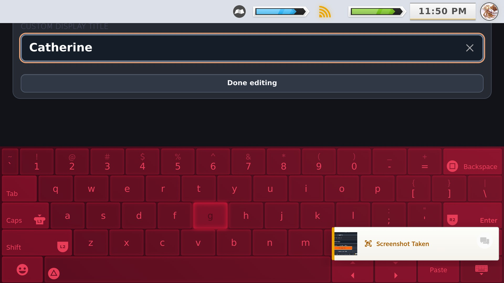
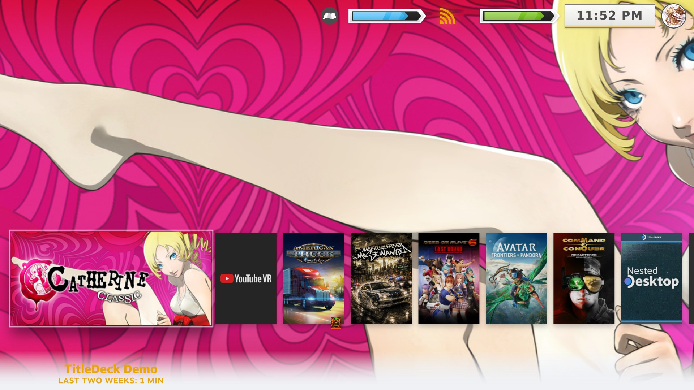

<h1 align="center">TitleDeck</h1>

<strong>Your library. Your names.</strong>

**TitleDeck** is a Decky Loader plugin for customizing **displayed Steam game titles** while leaving your installed games, sorting metadata and artwork unchanged.

> **Compatibility warning:** Developed and tested on a **physical Valve Steam Deck in SteamOS Gaming Mode**. **ROG Ally, other PC handhelds running alternative SteamOS-like systems, Steam Desktop Mode, Windows, Android/DroidDeck and other platforms are untested and may not work properly.** Steam UI / CSS Loader themes may also affect behavior. [Full compatibility statement](docs/COMPATIBILITY.md).

## 0.9.0 RC1 Steam Deck screenshots

Eight real screenshots of the current release, captured on the maintainer's Steam Deck. The original seven **0.8.1** screenshots are also preserved in the [gallery](docs/SCREENSHOTS.md).

| TitleDeck in Quick Access | Game library manager |
|:---:|:---:|
|  |  |
| Native Steam keyboard | Saved custom name in Steam |
|  |  |

[**View all eight current screenshots and seven older captures**](docs/SCREENSHOTS.md)

The originally uploaded screenshot ZIP was mistakenly labeled `0.9.1`. These images belong to **0.9.0 RC1**; no plugin-version change was made.

## Features

- Customize displayed Steam game names per App ID without changing the game's underlying sorting identity.
- Controller-first full game library manager with artwork, search and filters.
- Native Steam text input and physical-keyboard / paste support.
- **Suggest Cleanup** for unwanted trademark marks and capitalization, with original-versus-suggested preview, Apply, Keep and Undo.
- **Explicit Save Custom Title:** suggestions and keyboard edits never silently persist.
- Restore an individual name, or review and restore all with backup/recovery safeguards.
- Animated in-manager notices, clear D-pad highlights and version indicator.

## Device-verification summary

| Feature | Evidence |
| --- | --- |
| Rename Catherine Classic to Catherine and restore original | **Verified on physical Steam Deck** |
| Custom name survives Steam Deck restart | **Verified on physical Steam Deck** |
| The Sims 4 trademark cleanup review → Apply → Save | **Verified on physical Steam Deck** |
| Editor D-pad controls; Steam keyboard opening and readable input | **Verified on physical Steam Deck** |
| Timed notification / highlight improvements | **Verified on physical Steam Deck** |
| Closing Steam keyboard with B always restores layout | **Known intermittent issue** |
| 200+ name review, recovery edge cases, Steam background metadata refresh | **Not fully verified on hardware** |
| ROG Ally, other non-Deck SteamOS-like systems, Desktop Mode, Windows, Android | **Untested** |

[**Full hardware test matrix**](docs/VERIFIED_ON_DECK.md)

## Install / update

For **0.9.0 RC1**, download `TitleDeck-0.9.0-RC1-SteamDeck.zip` from [GitHub Releases](https://github.com/ValentineBSAA/TitleDeck/releases) and install via **Decky Loader → Developer → Install Plugin from ZIP**. The release is published under tag **`0.9.0`**; the plugin version inside the ZIP is **`0.9.0-rc.1`**. The previous **0.8.1** release is preserved.

In Gaming Mode, open **Quick Access → Decky → TitleDeck → Open full library manager**. Choose a game, edit using Change Name or review Suggest Cleanup, and explicitly press **Save Custom Title**. Back up your aliases before upgrading.

**Known keyboard behavior:** Steam may consume a B press without telling TitleDeck that its native keyboard closed; the editing area can stay raised. Use **Done editing** when that happens. The RC does not claim this is fixed.

[Installation instructions](docs/INSTALL.md) · [0.9.0 RC1 release notes](docs/RELEASE_NOTES_0.9.0_RC1.md) · [Roadmap](docs/ROADMAP.md)

## Open source and community

The 0.9.0 RC1 ZIP contains its matching frontend, backend and tests. The repository's `main.py`, `src/`, `dist/`, manifests and tests have been synchronized **byte-for-byte** with the checksum-verified, published RC1 installer. The public README and seven historical screenshots are preserved. [Source details](SOURCE.md).

[GitHub Issues](https://github.com/ValentineBSAA/TitleDeck/issues) · [Discussions](https://github.com/ValentineBSAA/TitleDeck/discussions) · [Support](SUPPORT.md). MIT licensed. Independent from Valve, Steam, Decky and game publishers.
