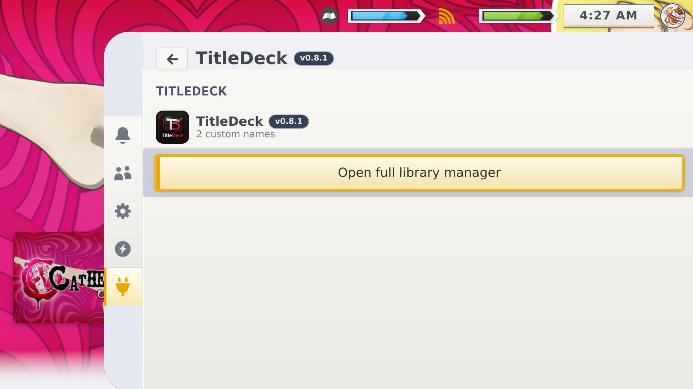
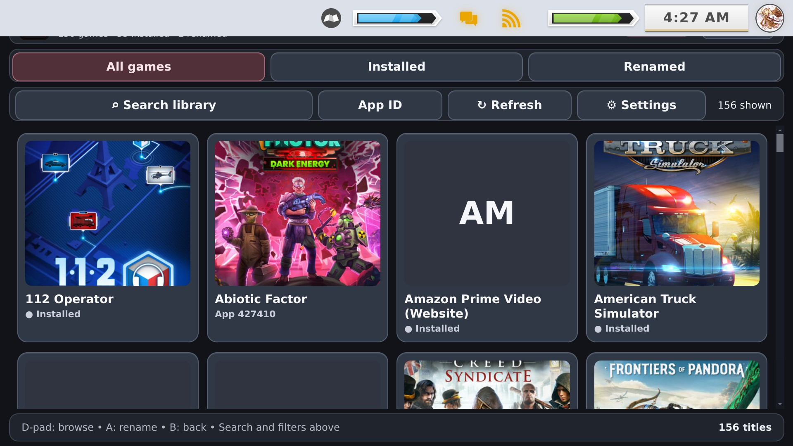

<p align="center"></p>
<h1 align="center">TitleDeck</h1>
<p align="center"><strong>Your library. Your names.</strong></p>
<p align="center">
  
  
  
  <a href="LICENSE"></a>
</p>

**TitleDeck** is a controller-first Decky Loader plugin for changing *displayed* Steam game titles in Gaming Mode. Rename `Catherine Classic` to `Catherine`, tidy capitalization, or remove unwanted ™/® symbols while leaving Steam's canonical metadata, sorting configuration, and installed game files untouched.

> **Compatibility warning:** TitleDeck is developed and device-tested on a **physical Valve Steam Deck running SteamOS Gaming Mode with Decky Loader**. **ROG Ally, other handheld PCs, third-party SteamOS installations or derivatives, Windows, Android/DroidDeck, and Desktop Mode are not verified or officially supported.** The interface, Decky integration, controller focus, and Steam keyboard may behave differently or fail on those systems.

> **0.9.0 RC source and documentation are prepared.** The **0.9.0 RC installer ZIP is awaiting upload by the maintainer** to [Releases](https://github.com/ValentineBSAA/TitleDeck/releases). Until it appears there, the [older 0.8.1 prerelease](https://github.com/ValentineBSAA/TitleDeck/releases/tag/0.8.1) remains the published download. Do not mistake the RC source snapshot for an already-published release.

## Features

- **Custom display names:** Save an alias for each Steam App ID without changing game installation or stored Steam sorting metadata.
- **Full-screen library manager:** Browse artwork, search/filter games, and choose a title using gamepad controls in Gaming Mode.
- **Native Steam keyboard:** Edit text in place, use Steam keyboard features or a connected physical keyboard; the normal game editor stays mounted.
- **Thoughtful cleanup:** Preview **current draft → suggested title**, deliberately apply or keep, undo a suggestion, then explicitly **Save Custom Title**. Preserves Unicode characters (including Σ) and Roman numerals.
- **Safe restoration:** Restore a single title or review and confirm Restore All. Automatic recovery snapshots and manual backups are available.
- **Controller-friendly UI:** Four-direction editor navigation, version label, short animated toast notifications.
- **Local and reversible:** No installer-time change to games or Steam's canonical library metadata.

## Screenshots

Real Steam Deck captures from the earlier 0.8.1 build. The 0.9.0 RC interface may differ; updated captures will replace/supplement these when available.

| Gaming Mode capture | Game library capture |
|:---:|:---:|
| [](docs/screenshots/v0.8.1/01-img-9119.jpg) | [](docs/screenshots/v0.8.1/02-img-9120.jpg) |

[**Browse all seven screenshots**](docs/SCREENSHOTS.md)

## Install or update

1. Install [Decky Loader](https://github.com/SteamDeckHomebrew/decky-loader) on a Valve Steam Deck.
2. Once published, download **`TitleDeck-0.9.0-RC.zip`** from [Releases](https://github.com/ValentineBSAA/TitleDeck/releases). Until then, the historical 0.8.1 download is available.
3. In Decky's developer controls, choose **Install Plugin from ZIP** and select the plugin ZIP.
4. Open **Quick Access → Decky → TitleDeck → Open full library manager**.
5. Select a game. Choose Change Name or Suggest Cleanup, review your draft, then select **Save Custom Title**.

Updating over an existing install should preserve saved aliases. For important data, use the built-in backup first. [Detailed setup and recovery](docs/INSTALL.md).

## Testing status

**Verified by the maintainer on a physical Steam Deck:** displayed title renaming (`Catherine Classic → Catherine`), persistence through a Steam Deck restart, restoring the original visible name, a real Sims 4 trademark-cleanup suggestion with **preview → Apply → Save**, native keyboard opening, the four-button editor, and timed notifications.

**Known intermittent issue:** After dismissing Steam's native keyboard with **B**, the editing panel can sometimes remain in its raised keyboard layout rather than settling down. The editor remains available on the same page; this is not marked fixed.

**Not yet independently verified:** Every Steam background metadata refresh; all library UI surfaces and CSS Loader themes; 200+ title review on physical hardware; non-Steam Deck systems. The fast-refresh code and extended review paths have automated coverage, which does **not** replace device testing.

| Evidence | Status |
| --- | --- |
| Real Valve Steam Deck features listed above | ✅ Maintainer-tested |
| Keyboard dismiss animation reliability | ⚠️ Intermittent issue |
| Background metadata refresh / all Steam surfaces | ⏳ Not fully tested |
| ROG Ally, other SteamOS devices, Windows, Android | ❔ Untested / unsupported |
| Local frontend/backend regression suite | ✅ Automated, not device proof |

[Detailed verification matrix](docs/VERIFIED_ON_DECK.md) · [Known limitations and device compatibility](docs/COMPATIBILITY.md) · [0.9.0 RC release notes](docs/RELEASE_NOTES_0.9.0-RC.md)

## For developers and contributors

Source: `src/index.js`, `dist/index.js`, `main.py`. Run:

```bash
node --test tests/frontend.test.cjs
python3 -m unittest discover -s tests -p test_backend.py
```

[Source and packaging](SOURCE.md) · [Roadmap](docs/ROADMAP.md) · [Contributing](CONTRIBUTING.md)

Bugs: [Issues](https://github.com/ValentineBSAA/TitleDeck/issues). Questions and suggestions: [Discussions](https://github.com/ValentineBSAA/TitleDeck/discussions). Include device and SteamOS/Decky/CSS Loader details with compatibility reports. [Support](SUPPORT.md).

MIT licensed. Created by Valentine. Independent of Valve, Steam, Decky Loader and game publishers.
