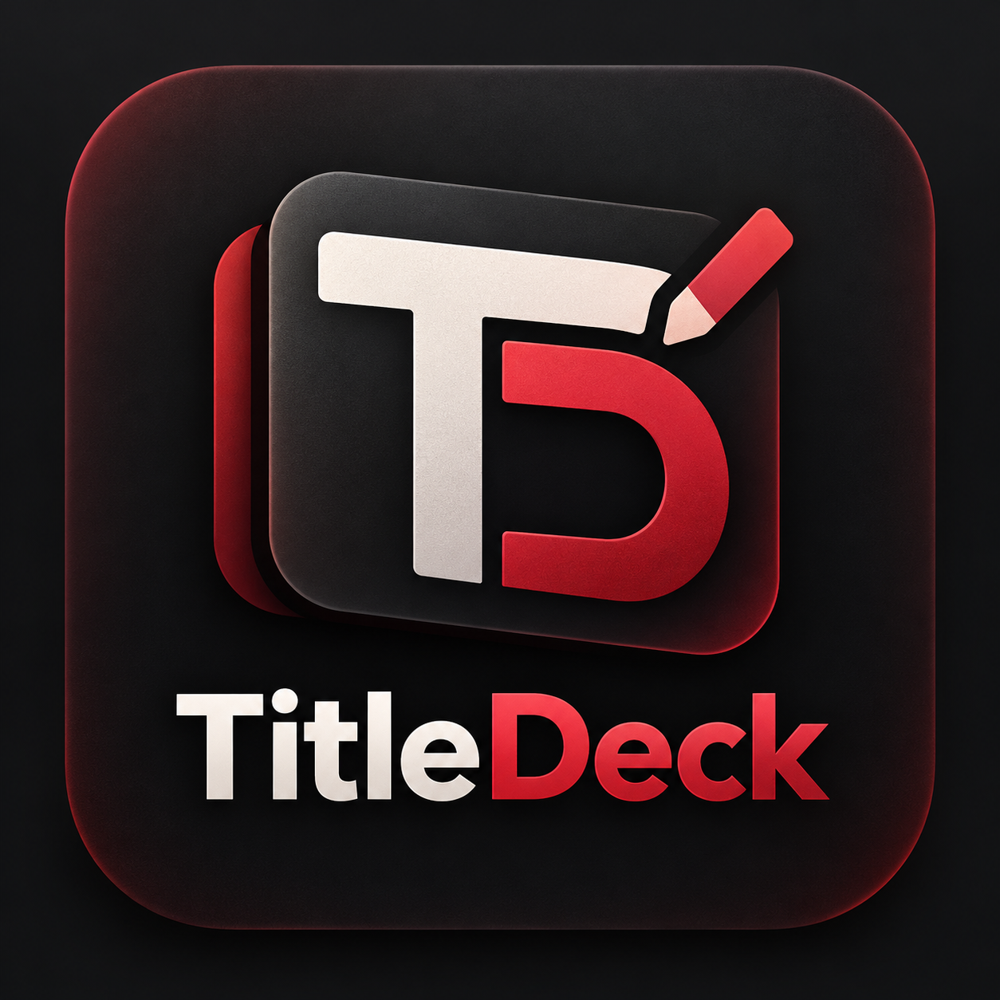
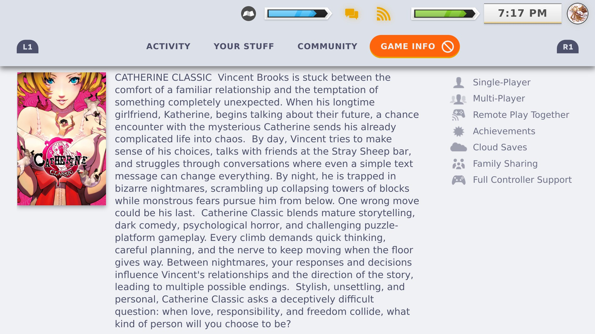
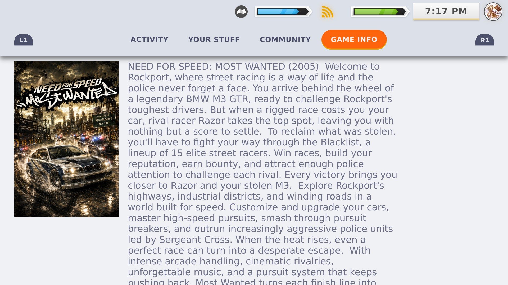
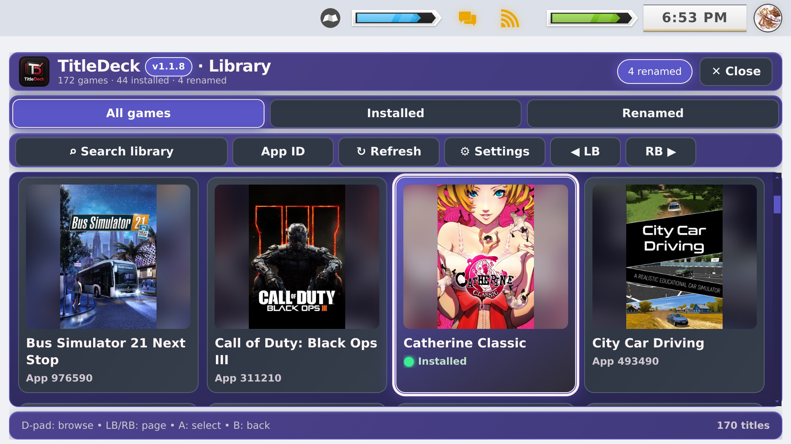
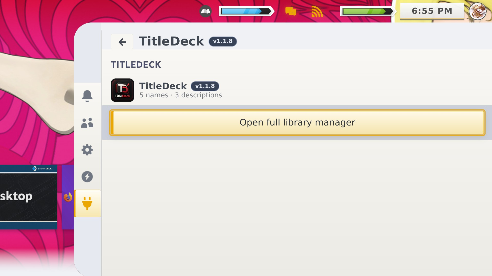

<h1 align="center">TitleDeck</h1>

<strong>Your library. Your names. Your descriptions.</strong>

**TitleDeck** is a free, community-made [Decky Loader](https://github.com/SteamDeckHomebrew/decky-loader) plugin that gives you control over the **displayed names and Game Info descriptions** in your Steam Deck library. It works with Steam titles **and non-Steam shortcuts**, and its customizations are local and reversible. It does not modify installed game files or Valve's canonical metadata.

**[⬇ Download TitleDeck 1.1.8](https://github.com/ValentineBSAA/TitleDeck/releases/tag/1.1.8)** · [🧭 Start here: beginner guide](docs/BEGINNER_GUIDE.md) · [🛠 Every feature](docs/FEATURES.md) · [📸 Full screenshot gallery](docs/SCREENSHOTS.md) · [❓ Troubleshooting](SUPPORT.md)

> [!NOTE]
> **Tested on a physical Steam Deck running SteamOS Gaming Mode.** The 1.1.8 release was tested with both the Steam Deck's built-in LB/RB buttons and a PS4 Bluetooth controller. Steam and non-Steam custom descriptions were verified after restarting the Deck. **Known limitation:** right-stick scrolling inside the **Game Info description area** currently does not respond reliably; this does **not** prevent saved descriptions from appearing or surviving restarts. [Tracked issue #8](https://github.com/ValentineBSAA/TitleDeck/issues/8). Other handhelds, Windows, Android/DroidDeck and Desktop Mode are not maintainer-verified.

## See it working on Steam Deck

**These images are genuine TitleDeck 1.1.8 captures.** The two Game Info examples deliberately distinguish a Steam game from a non-Steam shortcut.

| Steam game: Catherine Classic | Non-Steam game: Need for Speed Most Wanted 2005 |
|:---:|:---:|
|  |  |
| **Steam Game Info:** replace the displayed description for a game you own on Steam. | **Non-Steam Game Info:** personalize imported games while keeping their cover and Steam Play / Proton details. |

| Full Library Manager | Quick Access panel |
|:---:|:---:|
|  |  |

[**Browse all 23 screenshots, including the keyboard, both editors, search and every Settings page →**](docs/SCREENSHOTS.md)

## What can TitleDeck do?

| Feature | How it helps |
| --- | --- |
| **Rename displayed game titles** | Use Steam's on-screen keyboard to give Steam or non-Steam entries a local custom title. |
| **Suggest Cleanup** | Preview safer title formatting before you apply and explicitly save it. |
| **Write custom descriptions** | Personalize the real **Game Info** page for both Steam and non-Steam games, with no old yellow character-length warnings or enforced advisory cap. |
| **Choose description placement** | Pick **Game Info**, **Artwork Footer**, or **Below Play** inside TitleDeck Settings. |
| **Restore originals safely** | Restore the original name and description for one entry, or just its description. Bulk restores include confirmation and recovery safeguards. |
| **Use the full library grid** | Browse **All games / Installed / Renamed**, search by title or App ID, and select game artwork tiles. |
| **Use your controllers** | **D-pad**, **A**, **B**, **LB/RB paging**, on-screen controls, and touch. Both built-in Deck and PS4 Bluetooth shoulder paging passed physical tests. |
| **Get better cover art** | Steam artwork, custom grid images, local cache and fallback covers with attractive filled tile backgrounds. Unavailable art may display a placeholder. |
| **Hide unwanted manager entries** | **Hide tile** removes clutter (such as ES-DE (Program)) from TitleDeck only. It never deletes a Steam shortcut; Settings restores hidden entries. |
| **Personalize colors** | Wine Red styling, presets, visual hue/saturation picker, exact RGB/hex controls and controller navigation. |
| **Back up and recover** | Save a backup, restore it, recover after Restore All, or review a bulk restore before confirming. |

## Install in Gaming Mode

1. Install [Decky Loader](https://github.com/SteamDeckHomebrew/decky-loader) on your Steam Deck if you have not already.
2. Download **[TitleDeck-1.1.8.zip](https://github.com/ValentineBSAA/TitleDeck/releases/download/1.1.8/TitleDeck-1.1.8.zip)**. **Do not extract the plugin ZIP.**
3. Open **Quick Access (•••) → Decky Loader (plug icon) → Decky Settings (gear) → Developer → Install Plugin from ZIP**. Select the downloaded ZIP. The wording may differ slightly with Decky versions.
4. Go back to **Quick Access → Decky → TitleDeck → Open Full Library Manager**.
5. Select a game to rename it or edit its description. **Save the change** and open the game's **Game Info** tab to see the description.

**Not sure where Settings are?** Open **Full Library Manager → ⚙ Settings** to find backups, description placement, right-stick option, themes, hidden entries, and Restore All. See the [illustrated beginner guide](docs/BEGINNER_GUIDE.md).

## Controller quick reference

**D-pad:** browse · **A:** select · **B:** back · **LB/RB:** page Full Library Manager (Deck and PS4 confirmed) · **Touch:** tap and scroll · **Right stick:** scroll longer *TitleDeck manager/editor/settings workspaces* where supported. **Game Info description-area right-stick scrolling is a known issue** in this version. See [input differences](docs/FEATURES.md#controller-controls-and-scrolling).

## Community-made and reversible

TitleDeck began with community interest in renaming Steam Deck games. **u/TacoOfGod** helped inspire the title-customization idea, and **u/All-Stars64** suggested editable descriptions right inside **Game Info**, beside Community. Thanks to everyone reporting bugs and testing builds on real hardware. These credits acknowledge feature ideas and feedback, not code authorship.

## More information

[Complete beginner guide](docs/BEGINNER_GUIDE.md) · [Feature reference](docs/FEATURES.md) · [1.1.8 release notes](docs/RELEASE_NOTES_1.1.8.md) · [Verified on Deck](docs/VERIFIED_ON_DECK.md) · [Compatibility](docs/COMPATIBILITY.md) · [Installation](docs/INSTALL.md) · [Changelog](CHANGELOG.md) · [Source and checksums](SOURCE.md) · [Contributing](CONTRIBUTING.md) · [Issues](https://github.com/ValentineBSAA/TitleDeck/issues) · [Discussions](https://github.com/ValentineBSAA/TitleDeck/discussions).

MIT licensed. Independent of Valve, Steam, Decky Loader and game publishers.
