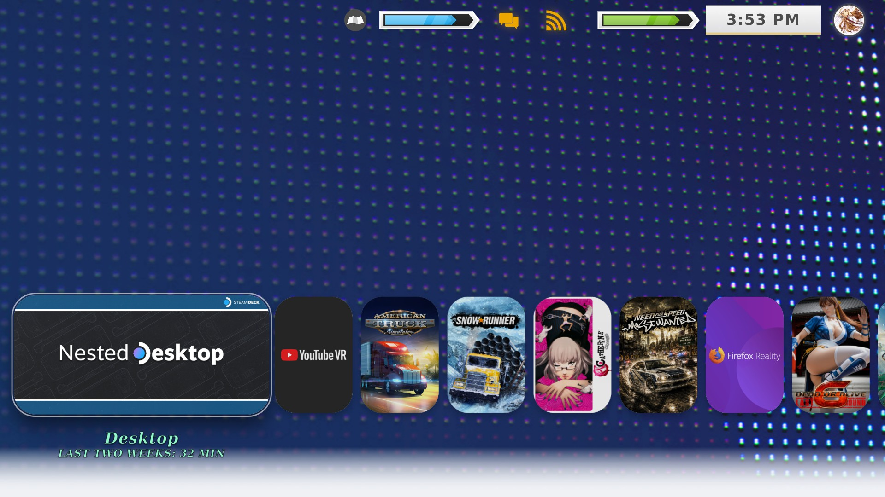

<h1 align="center">TitleDeck</h1>

<strong>Your library, with your personality.</strong>

  
  
  
  

**TitleDeck** is a free [Decky Loader](https://github.com/SteamDeckHomebrew/decky-loader) plugin for customizing how **Steam and non-Steam games** are presented in Steam Deck Gaming Mode. Rename their displayed titles, write your own Game Info descriptions, restore originals, and personalize Steam Home typography. Changes are local and reversible. Your game installations and Valve's original metadata are not rewritten.

### Get started
**[⬇️ Download TitleDeck 1.4.0](https://github.com/ValentineBSAA/TitleDeck/releases/download/1.4.0/TitleDeck-1.4.0.zip)** · [Installation guide](docs/INSTALL.md) · [Beginner's guide](docs/BEGINNER_GUIDE.md) · [Release notes](docs/RELEASE_NOTES_1.4.0.md)

> [!IMPORTANT]
> Install **`TitleDeck-1.4.0.zip`**, not the screenshot archive or GitHub's automatic source archive. Decky Loader → Settings → Developer → **Install Plugin from ZIP**. Existing local customizations should be preserved during an in-place upgrade; a backup is recommended.

## A more personal Steam library
| Make it yours | What TitleDeck does |
| --- | --- |
| **Titles & descriptions** | Edit locally displayed names and Game Info descriptions for Steam and non-Steam titles; restore originals. |
| **Full Library Manager** | Browse, filter, search and manage entries with game artwork, focus-aware controls and LB/RB navigation. |
| **Typography Studio** | Customize Home text using font-style presets, custom HEX/RGB colors, outlines, shadows, glow and readability previews. |
| **Steam Home layout** | Position TitleDeck's own titles above or below cards when Art Hero is not active. |
| **Safe recovery** | Backups, restoration, hidden-entry recovery and local configuration management. |
| **Quick Access** | Open the manager and discover useful controls without leaving Gaming Mode. |

[Explore every feature](docs/FEATURES.md) · [See the **22 new 1.4.0 screenshots**](docs/SCREENSHOTS.md) · [Download the original organized screenshot archive](https://github.com/ValentineBSAA/TitleDeck/releases/download/1.4.0/TitleDeck-1.4.0-Organized-Screenshots.zip)

## What's changed since 1.2.2?
Version 1.2.2 introduced the developer profile shortcut and carried forward the essential editing features. The work that followed transformed the experience: refined manager navigation and artwork loading, redesigned Settings, richer typography and color controls, and safer coexistence with CSS Loader's Art Hero.

**[Read the complete 1.2.2 → 1.4.0 comparison](docs/UPDATE_FROM_1.2.2.md)** for a feature-by-feature breakdown, the development journey, and what was deliberately left for later.

## Art Hero: designed to avoid conflicting controls
When **CSS Loader → Art Hero** is enabled, Art Hero owns Steam Home title position. TitleDeck can show its **Carousel Font Height** and Above/Below indicator, but those controls are **read-only** in 1.4.0. Adjust Art Hero in **CSS Loader**, not TitleDeck. With Art Hero disabled, TitleDeck's own placement controls are available.

This limitation is intentional: earlier experimental cross-plugin writes did not work reliably on physical hardware. [Why we made this choice](docs/ART_HERO_COMPATIBILITY.md)

## Tested, with honest limits
The developer reports extensive physical Steam Deck testing of 1.4.0's accessible features. The exact released installer passed the packaging audit and matched the provided source; **79 JavaScript and five Python tests** passed locally. The installer and screenshot ZIP checksums were independently matched to GitHub release assets.

Known areas not claimed fixed: **built-in Deck right-stick scrolling** inside Game Info descriptions ([issue #8](https://github.com/ValentineBSAA/TitleDeck/issues/8)); an earlier Quick Access focus quirk; custom font ZIP importing; and variations across CSS Loader themes. [Compatibility & test notes](docs/COMPATIBILITY.md) · [Support](SUPPORT.md)

## Documentation
[Install](docs/INSTALL.md) · [Start here](docs/BEGINNER_GUIDE.md) · [Features](docs/FEATURES.md) · [Gallery](docs/SCREENSHOTS.md) · [1.4.0 release notes](docs/RELEASE_NOTES_1.4.0.md) · [Changelog](CHANGELOG.md) · [Troubleshooting](SUPPORT.md) · [Source & verification](SOURCE.md) · [Roadmap](docs/ROADMAP.md) · [Contribute](CONTRIBUTING.md)

## Made with the community ❤️
TitleDeck started with a simple request from Steam Deck users: **let me make my library look the way I want**. Every useful bug report, suggestion, test, download, and quiet moment of enjoyment has helped guide it forward. Thank you to the people who shared the original ideas for titles and descriptions, those who tested updates, and everyone who has given this project a place on their Deck.

This is an independent, community-made plugin and is not affiliated with Valve. Released under the [MIT License](LICENSE).

<strong>your titles you're deck!</strong>

