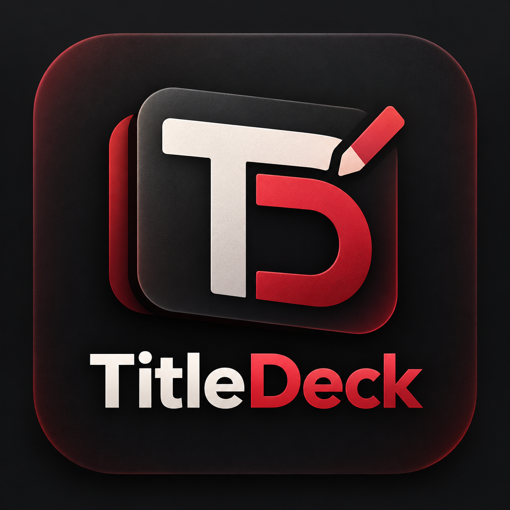
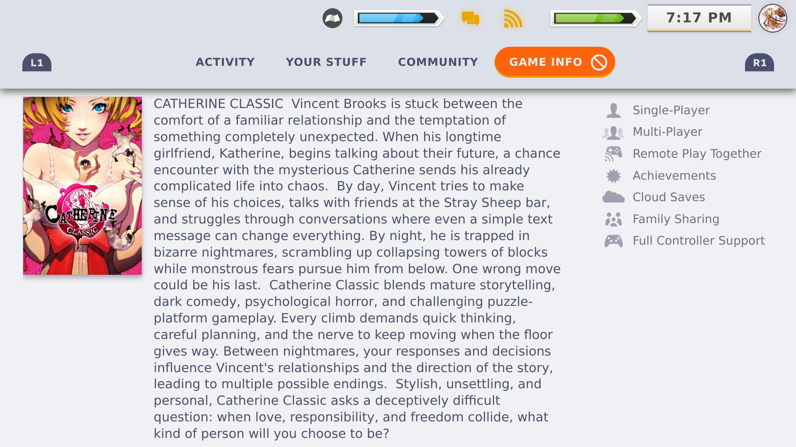
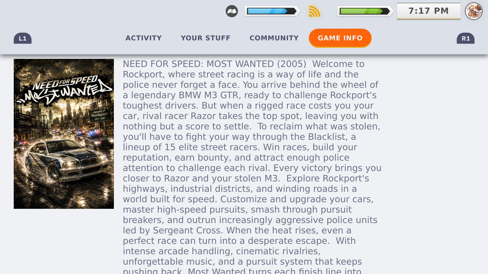
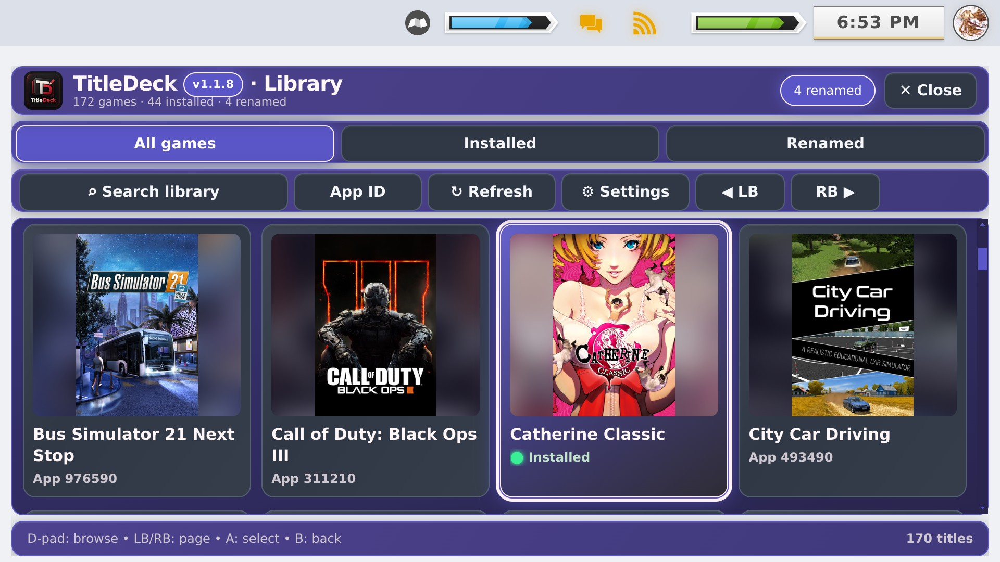
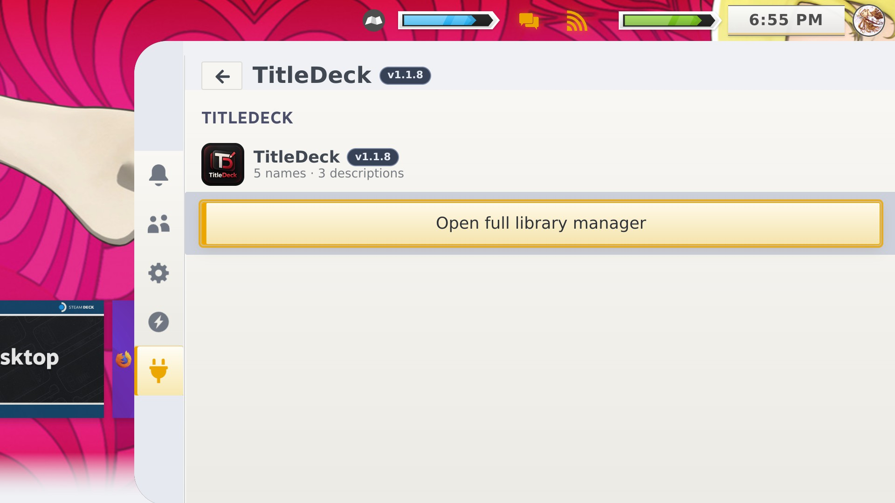

<h1 align="center">TitleDeck</h1>

<strong>Your library. Your names. Your descriptions.</strong>

**TitleDeck** is a free, community-made [Decky Loader](https://github.com/SteamDeckHomebrew/decky-loader) plugin that gives you control over the **displayed names and Game Info descriptions** in your Steam Deck library. It works with Steam titles **and non-Steam shortcuts**, and its customizations are local and reversible. It does not modify installed game files or Valve's canonical metadata.

**[⬇ Download TitleDeck 1.2.2](https://github.com/ValentineBSAA/TitleDeck/releases/tag/1.2.2)** · [🧭 Start here: beginner guide](docs/BEGINNER_GUIDE.md) · [🛠 Every feature](docs/FEATURES.md) · [📸 Full screenshot gallery](docs/SCREENSHOTS.md) · [❓ Troubleshooting](SUPPORT.md)

> [!NOTE]
> **Tested on a physical Steam Deck running SteamOS Gaming Mode.** The 1.1.8 release was tested with both the Steam Deck's built-in LB/RB buttons and a PS4 Bluetooth controller. Steam and non-Steam custom descriptions were verified after restarting the Deck. **Known limitation:** the Steam Deck's **built-in right stick** does not scroll custom text inside the **Game Info description area**, while an **external controller's right stick does scroll** both Steam and non-Steam Game Info descriptions. This does **not** prevent descriptions from appearing, saving or surviving restarts. [Tracked issue #8](https://github.com/ValentineBSAA/TitleDeck/issues/8). ROG Ally, other handhelds, Windows, Android/DroidDeck and Desktop Mode are not maintainer-verified.

> [!IMPORTANT]
> **TitleDeck 1.2.2 Stable:** I added my own GitHub profile logo as a controller-focusable button in Quick Access. I tested it on my Steam Deck and confirmed it opens my GitHub profile.** TitleDeck 1.2.1's previously verified library features remain in 1.2.2. The STEAM-button menu shows aliases for running Steam and non-Steam games, and the game's **Options (☰) → Edit with TitleDeck** opens its editor directly. In Full Library Manager → Settings, choose **After Developer** or **Before Properties** for menu placement. From a context-launched editor, **hold B / Circle for 650 ms** to return straight to Steam (hardware verified). [1.2.1 release notes](docs/RELEASE_NOTES_1.2.1.md) · [hardware tests](docs/RELEASE_TEST_RESULTS_1.2.1.md) · [verification checklist](docs/VERIFIED_ON_DECK.md).

## A note from me 🌸

I started TitleDeck because I thought changing the names and descriptions shown in your own Steam library should be an option. The first idea came from the community, and other suggestions helped turn it into something much bigger than a simple renaming tool. I built it, tested it on my Steam Deck, and kept working through the rough edges because I wanted it to feel natural in Gaming Mode.

With **1.2.2**, I've added my personal GitHub logo to the Quick Access panel. If you want to know who made TitleDeck or find my other projects, you can select it and go straight to [my GitHub profile](https://github.com/ValentineBSAA). It's a small signature, not an extra step to use the plugin.

To everyone who's downloaded TitleDeck, tried it out, tested a build, reported a bug, or offered an idea: **thank you**. I really appreciate people giving something I've developed a chance, including those who simply use it without saying a word. [Read my 1.2.2 release note](docs/RELEASE_NOTES_1.2.2.md).

## See it working on Steam Deck

**These historical images are genuine TitleDeck 1.1.8 captures; 1.2.1's features and 1.2.2's new developer link are described above.** The two Game Info examples deliberately distinguish a Steam game from a non-Steam shortcut.

| Steam game: Catherine Classic | Non-Steam game: Need for Speed Most Wanted 2005 |
|:---:|:---:|
|  |  |
| **Steam Game Info:** replace the displayed description for a game you own on Steam. | **Non-Steam Game Info:** personalize imported games while keeping their cover and Steam Play / Proton details. |

| Full Library Manager | Quick Access panel |
|:---:|:---:|
|  |  |

[**Browse all 23 screenshots, including the keyboard, both editors, search and every Settings page →**](docs/SCREENSHOTS.md)

## What can TitleDeck do?

| Feature | How it helps |
| --- | --- |
| **Rename displayed game titles** | Use Steam's on-screen keyboard to give Steam or non-Steam entries a local custom title. |
| **Suggest Cleanup** | Preview safer title formatting before you apply and explicitly save it. |
| **Write custom descriptions** | Personalize the real **Game Info** page for both Steam and non-Steam games, with no old yellow character-length warnings or enforced advisory cap. |
| **Choose description placement** | Pick **Game Info**, **Artwork Footer**, or **Below Play** inside TitleDeck Settings. |
| **Restore originals safely** | Restore the original name and description for one entry, or just its description. Bulk restores include confirmation and recovery safeguards. |
| **Use the full library grid** | Browse **All games / Installed / Renamed**, search by title or App ID, and select game artwork tiles. |
| **Use your controllers** | **D-pad**, **A**, **B**, **LB/RB paging**, on-screen controls, and touch. Both built-in Deck and PS4 Bluetooth shoulder paging passed physical tests. |
| **Get better cover art** | Steam artwork, custom grid images, local cache and fallback covers with attractive filled tile backgrounds. Unavailable art may display a placeholder. |
| **Hide unwanted manager entries** | **Hide tile** removes clutter (such as ES-DE (Program)) from TitleDeck only. It never deletes a Steam shortcut; Settings restores hidden entries. |
| **Personalize colors** | Wine Red styling, presets, visual hue/saturation picker, exact RGB/hex controls and controller navigation. |
| **Back up and recover** | Save a backup, restore it, recover after Restore All, or review a bulk restore before confirming. |

## Install in Gaming Mode

1. Install [Decky Loader](https://github.com/SteamDeckHomebrew/decky-loader) on your Steam Deck if you have not already.
2. Download **[TitleDeck-1.2.2-Stable.zip](https://github.com/ValentineBSAA/TitleDeck/releases/download/1.2.2/TitleDeck-1.2.2-Stable.zip)**. **Do not extract the plugin ZIP.**
3. Open **Quick Access (•••) → Decky Loader (plug icon) → Decky Settings (gear) → Developer → Install Plugin from ZIP**. Select the downloaded ZIP. The wording may differ slightly with Decky versions.
4. Go back to **Quick Access → Decky → TitleDeck → Open Full Library Manager**.
5. Select a game to rename it or edit its description. **Save the change** and open the game's **Game Info** tab to see the description.

**My developer logo:** In Quick Access, focus the **ValentineBSAA** button beneath **Open Full Library Manager** and press **A**, or tap it, to visit my GitHub profile. I confirmed it works on my Steam Deck in 1.2.2.

**Not sure where Settings are?** Open **Full Library Manager → ⚙ Settings** to find backups, description placement, right-stick option, themes, hidden entries, and Restore All. See the [illustrated beginner guide](docs/BEGINNER_GUIDE.md).

## Controller quick reference

**D-pad:** browse · **A:** select · **B:** back · **LB/RB:** page Full Library Manager (Deck and PS4 confirmed) · **Touch:** tap and scroll · **Right stick:** scroll longer *TitleDeck manager/editor/settings workspaces* where supported. **In Game Info, an external controller's right stick works for both game types, but the Steam Deck's built-in right stick does not** ([issue #8](https://github.com/ValentineBSAA/TitleDeck/issues/8)). See [input differences](docs/FEATURES.md#controller-controls-and-scrolling).

## Community-made and reversible

TitleDeck began with ideas shared by the Steam Deck community. **u/TacoOfGod** helped inspire the title-renaming feature, and **u/All-Stars64** suggested editable descriptions in **Game Info**, beside Community. I turned those ideas into a working plugin and continued improving it through testing and feedback. Thank you to everyone who's tried TitleDeck, helped test it, or pointed out something I could improve. These credits recognize community suggestions and testing, not code authorship.

## More information

[Complete beginner guide](docs/BEGINNER_GUIDE.md) · [Feature reference](docs/FEATURES.md) · [1.2.2 release notes](docs/RELEASE_NOTES_1.2.2.md) · [1.2.1 history](docs/RELEASE_NOTES_1.2.1.md) · [Verified on Deck](docs/VERIFIED_ON_DECK.md) · [Compatibility](docs/COMPATIBILITY.md) · [Installation](docs/INSTALL.md) · [Changelog](CHANGELOG.md) · [Source and checksums](SOURCE.md) · [Contributing](CONTRIBUTING.md) · [Issues](https://github.com/ValentineBSAA/TitleDeck/issues) · [Discussions](https://github.com/ValentineBSAA/TitleDeck/discussions).

MIT licensed. Independent of Valve, Steam, Decky Loader and game publishers.
