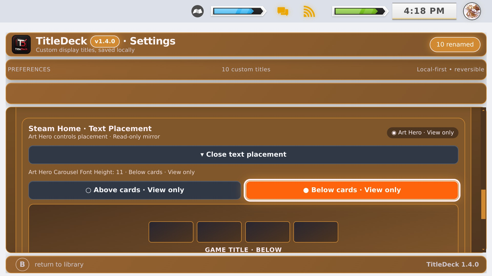

# Art Hero and TitleDeck 1.4.0
[← Home](../README.md) · [Steam Home features](FEATURES.md) · [Screenshots](SCREENSHOTS.md)

## Who controls the placement?
- **Art Hero enabled:** Art Hero owns the Steam Home title position. TitleDeck displays Carousel Font Height and indicates whether its value corresponds to above/below the cards, but its Art Hero position buttons are **visible and disabled**. No write is sent to Art Hero.
- **Art Hero disabled or absent:** TitleDeck's own Above Cards/Below Cards placement settings and saved offsets can be used.
- **Art Hero state unknown:** TitleDeck conservatively avoids competing with a theme until ownership is clear.

## How do I move the text while Art Hero is on?
Open **CSS Loader → Art Hero → Carousel Font Height**. Negative values generally move text above cards; positive values generally move it below. The setting belongs to the theme.

## Why is the control disabled?
During 1.3.7–1.3.9, a cross-plugin experiment could read Art Hero configuration but did not reliably write placement changes on the actual Steam Deck. Shipping a button that looks functional but doesn't move anything would mislead users. Version 1.4.0 explicitly marks it as read-only and rejects those write operations.

The small placement diagram is explanatory, **not** a pixel-accurate live preview. CSS Loader theme changes and SteamOS updates may change the visual outcome.

Please include your SteamOS and theme versions and steps to reproduce when reporting an interaction problem.
