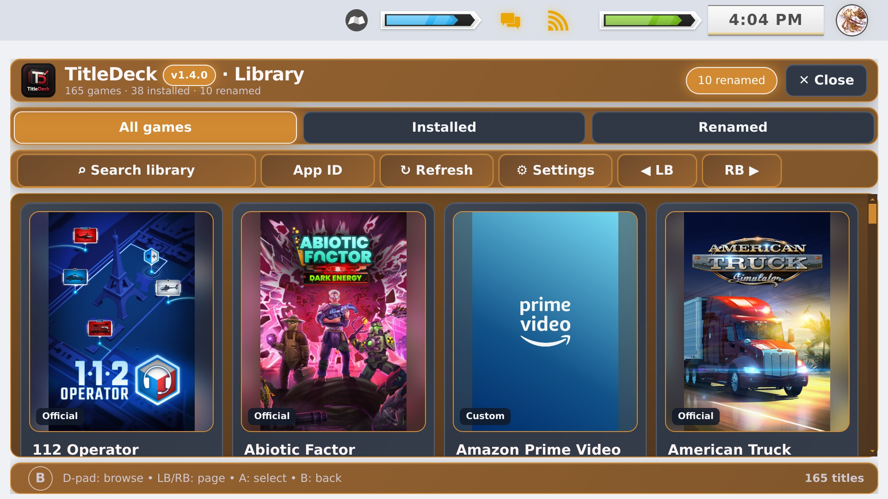
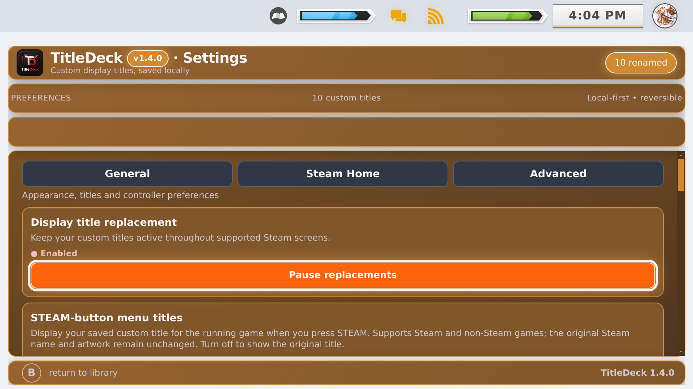
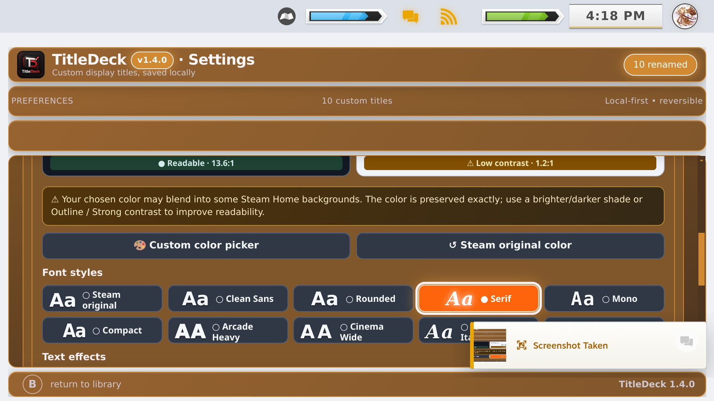
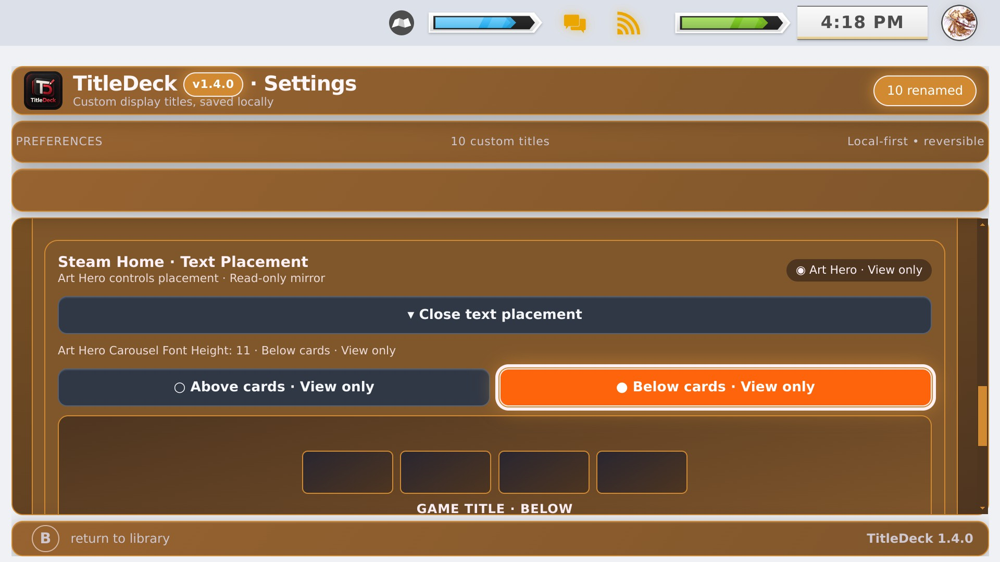
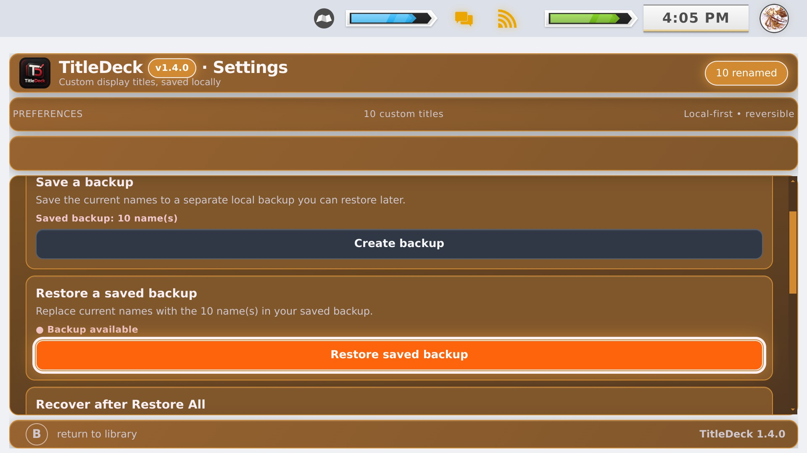

# Start here: TitleDeck 1.4.0
[← Home](../README.md) · [Install](INSTALL.md) · [Features](FEATURES.md) · [Pictures](SCREENSHOTS.md)

TitleDeck changes **what you see in Gaming Mode**, not the names of installed game files. It supports Steam games and non-Steam shortcuts.

## 1. Open TitleDeck
Open the Steam Deck's **••• Quick Access menu**, choose Decky Loader and select **TitleDeck**. Choose **Open Full Library Manager** to browse the collection.

## 2. Customize one game
Choose a title in the manager. Edit its displayed name or write a custom Game Info description, then save. You can also open the TitleDeck editor directly from a game's native **Options → Edit with TitleDeck** shortcut when present.

## 3. Make Steam Home look like yours
Open **Full Library Manager → Settings → Steam Home**. Try a preset, adjust the color with the HEX/RGB picker, and explore the Typography Studio's font styles, outlines, shadow and glow. Use the light/dark previews for readability guidance, not as an exact on-device replica.

## 4. Understand title placement
Without Art Hero, TitleDeck can position its own titles above or below cards. With **Art Hero enabled**, the placement buttons are intentionally disabled. TitleDeck only *shows* Art Hero's current position. Make any changes inside **CSS Loader → Art Hero → Carousel Font Height**.

## 5. Back up or restore
You can restore original display names and use the backup/recovery settings before major changes. Backups are especially useful before theme experimentation.

## Want more?
[22-image gallery](SCREENSHOTS.md) · [Full features](FEATURES.md) · [What's changed from 1.2.2](UPDATE_FROM_1.2.2.md) · [Help & support](../SUPPORT.md).

A [historical 1.2.2 guide](HISTORICAL_BEGINNER_GUIDE_1.2.2.md) is kept for longtime users comparing the older interface.
