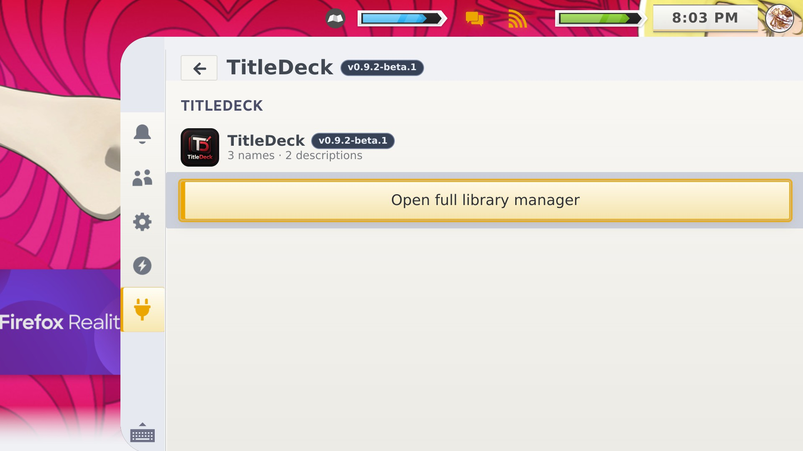
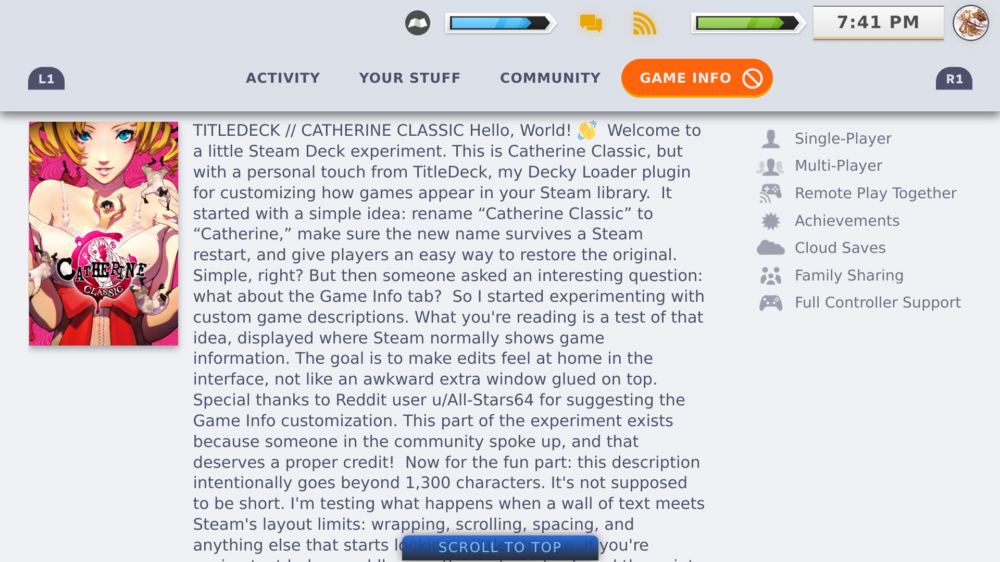
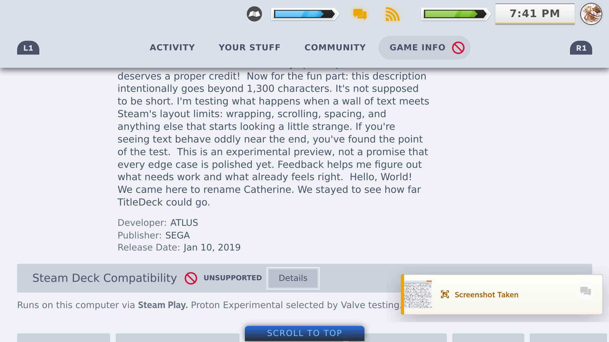
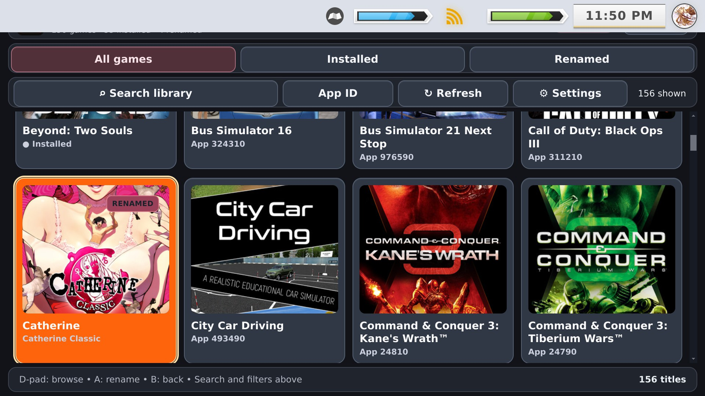

# TitleDeck screenshot gallery

## Upcoming 1.1.8 gallery

**Status:** Images are being prepared by the maintainer. The 1.1.8 release candidate has been hardware-tested, but its new screenshot files have **not yet been supplied**.

The gallery is ready to feature the **Full Library Manager**, installed badges and cover tiles, **Steam and non-Steam Game Info descriptions**, title editing, Settings / custom colors, and restoration. When the images arrive, they will be published as individual image files under `docs/screenshots/v1.1.8/` and linked here. **The incoming screenshots ZIP itself will not become a release asset.**

Please distinguish screenshots from the **historical 0.9.x** builds and do not claim the right stick currently scrolls Steam's Game Info description area. [Screenshot upload guide](SCREENSHOT_UPLOAD_GUIDE.md).

## Historical screenshot archive

> **1.1.8 screenshots are being prepared.** The maintainer's upcoming screenshot ZIP will be treated as an **image source**, not committed as a ZIP or attached as a public release asset. Selected images will be extracted into `docs/screenshots/v1.1.8/` and linked here and in the README.

[Back to README](../README.md) · [1.1.8 release notes](RELEASE_NOTES_1.1.8.md)

## Coming in the 1.1.8 gallery

- Quick Access and version badge.
- Full Library Manager grid, installed indicators, and full-bleed artwork.
- Custom Steam **Game Info** description.
- Custom non-Steam **Game Info** description with side-by-side cover.
- Description editor and title editing.
- TitleDeck Settings, color picker, and description placement.
- Reversible hidden-tile option.

The gallery will not be filled with invented captures or stale images relabeled as 1.1.8. See [screenshot submission instructions](screenshots/v1.1.8/README.md).

## Historical 0.9.2 Beta 1 (not the current UI)

| Quick Access from Beta 1 | Game Info customization during Beta 1 |
|:---:|:---:|
|  |  |
| Long description from Beta 1 | Full manager from the older RC1 |
|  |  |

The historical screenshot gallery is preserved under `docs/screenshots/v0.8.1/`, `docs/screenshots/v0.9.0-rc1/`, and `docs/screenshots/v0.9.2-beta1/`. Original screenshots carry their original version badges; no historical image is claimed to show 1.1.8.

