# TitleDeck 1.4.0 screenshot gallery
[← Home](../README.md) · [Features](FEATURES.md) · [Release notes](RELEASE_NOTES_1.4.0.md) · [Download all 22 images](https://github.com/ValentineBSAA/TitleDeck/releases/download/1.4.0/TitleDeck-1.4.0-Organized-Screenshots.zip)

These are **22 real, unaltered 1920×1080 Steam Deck captures**, organized for browsing. **12 featured screenshots** are shown below; **10 additional references** are listed afterward. The original organized ZIP, including its manifest and captions, is attached to the 1.4.0 GitHub release. Historical 1.1.8 screenshots remain [archived](SCREENSHOTS_1.1.8_ARCHIVE.md).

## Featured: explore 1.4.0

### 01. Personalized Steam Home text and glow
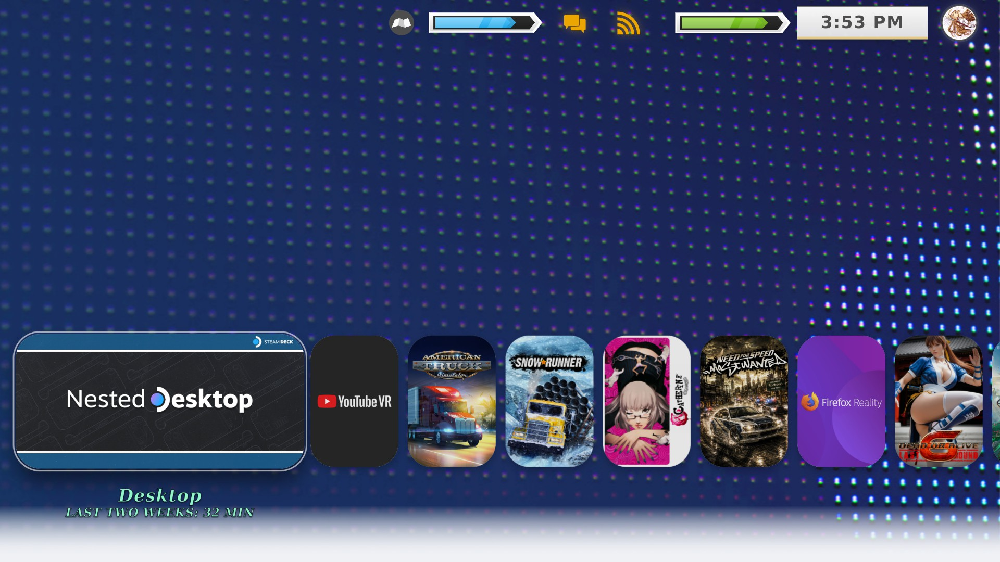

### 02. Browse the Full Library Manager
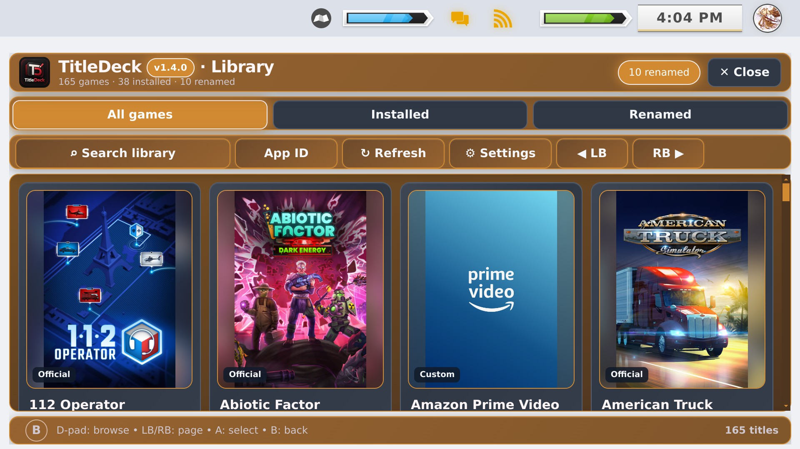

### 03. Custom labels across library entries
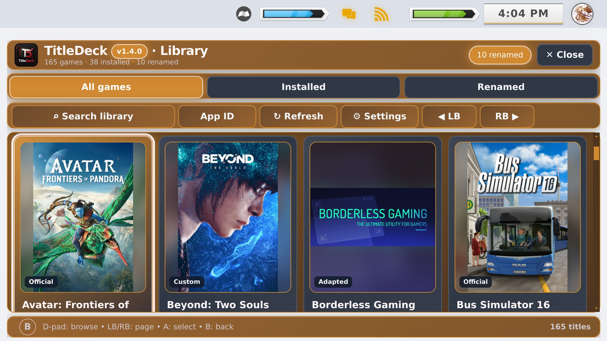

### 04. Quick Access presentation
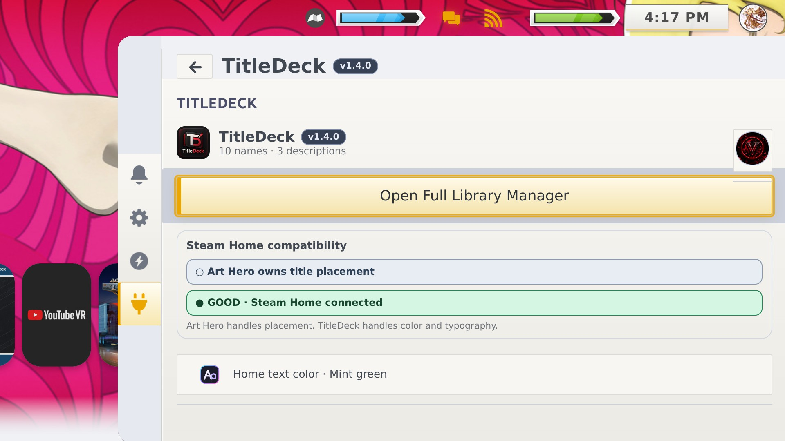

### 05. Display title editing
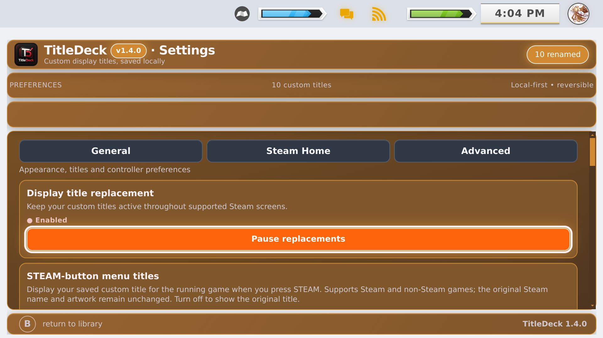

### 06. Custom Game Info description editing
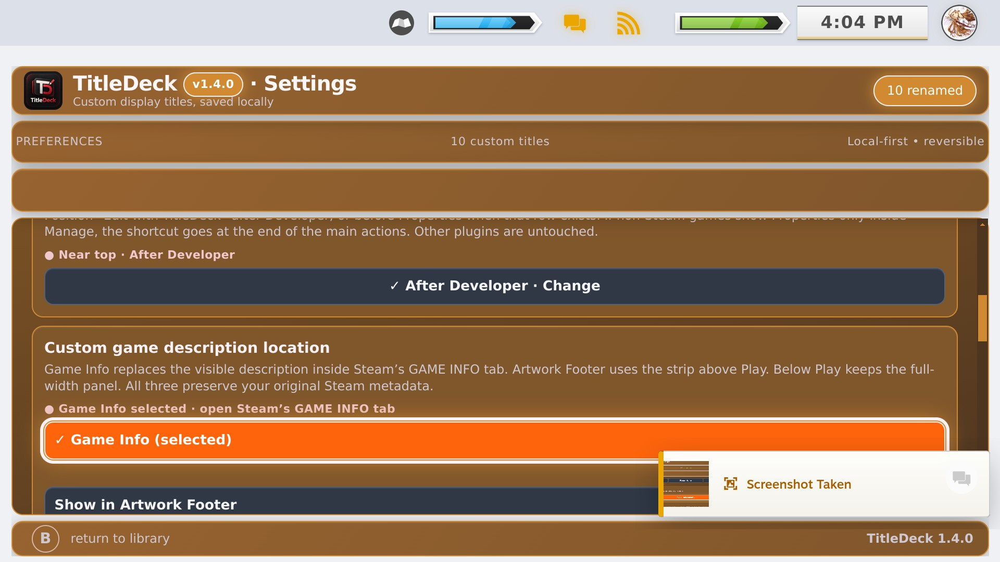

### 07. Color preset choices
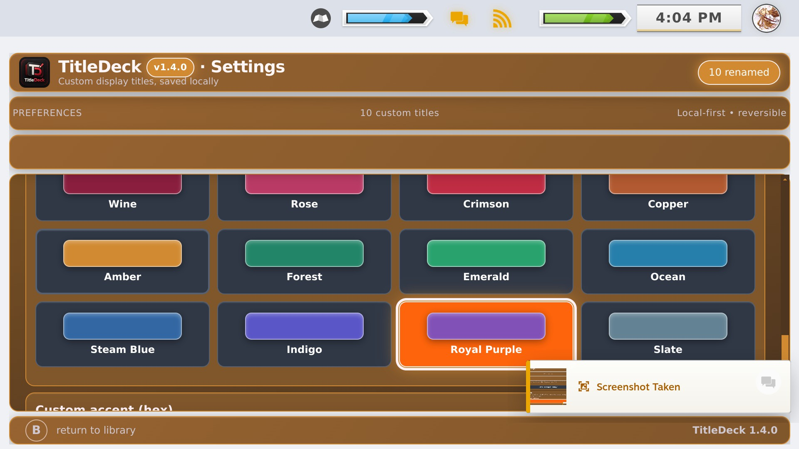

### 08. Typography Studio font styles
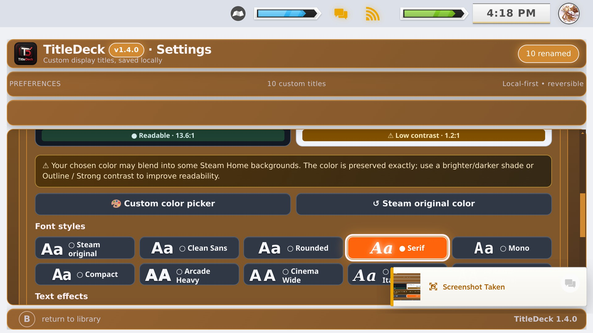

### 09. Typography effects and readability options
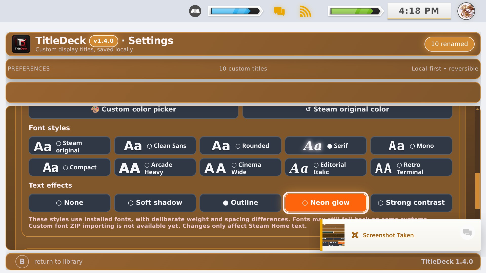

### 10. Steam Home text settings
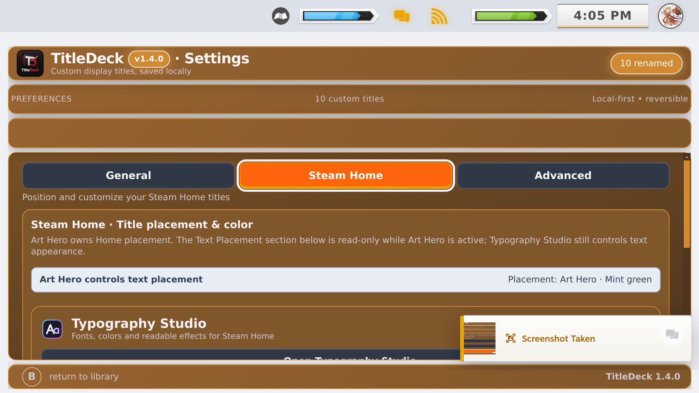

### 11. Art Hero information, visible but read-only
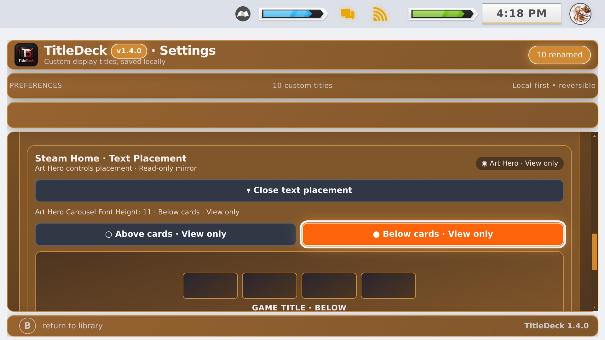

### 12. Backup and restoration controls
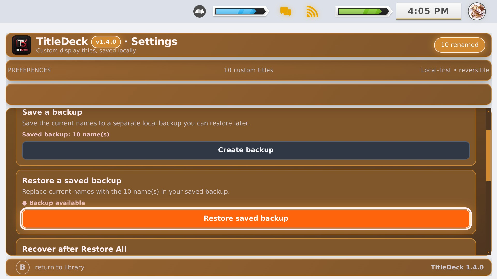

> [!NOTE]
> The Art Hero position view pictured here is **read-only** when that theme is enabled. Changes must be made within CSS Loader.

## More detail: 10 supplementary screenshots
- [Game Info description details](screenshots/v1.4.0/13-game-info-description-details.jpeg)
- [Color picker and swatches](screenshots/v1.4.0/14-color-picker-and-swatches.jpeg)
- [Custom HEX color](screenshots/v1.4.0/15-custom-hex-color.jpeg)
- [Steam Home placement details](screenshots/v1.4.0/16-steam-home-placement-details.jpeg)
- [Typography expanded section](screenshots/v1.4.0/17-typography-section-expansion.jpeg)
- [Recovery and hidden entries](screenshots/v1.4.0/18-recovery-and-hidden-entries.jpeg)
- [Hidden entries and original titles](screenshots/v1.4.0/19-hidden-entries-and-original-titles.jpeg)
- [Advanced settings](screenshots/v1.4.0/20-advanced-settings-tab.jpeg)
- [Light/dark color preview](screenshots/v1.4.0/21-light-dark-color-preview.jpeg)
- [Art Hero positioning explanation](screenshots/v1.4.0/22-art-hero-placement-explanation.jpeg)

The archived images from earlier releases are never presented as current 1.4.0 UI. [Read what changed since 1.2.2](UPDATE_FROM_1.2.2.md).
