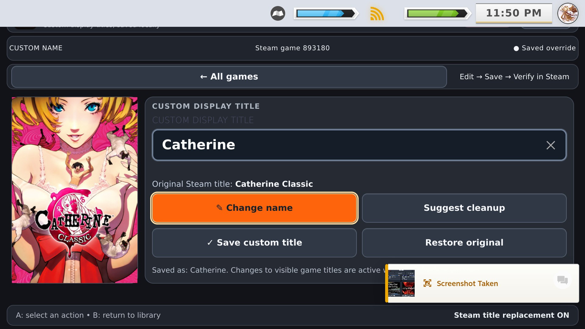
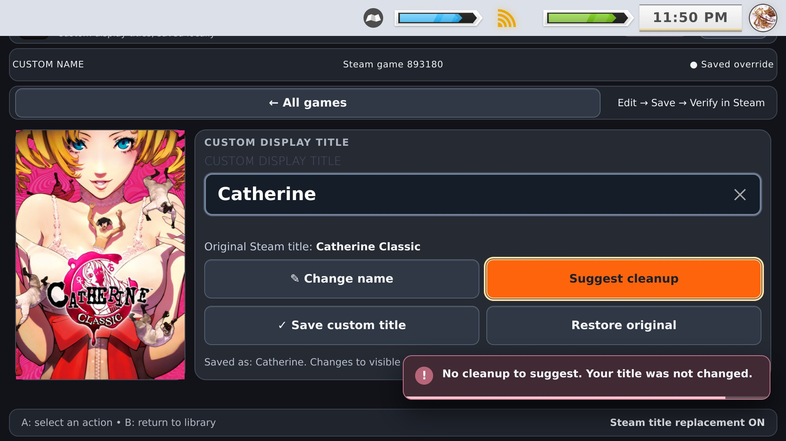
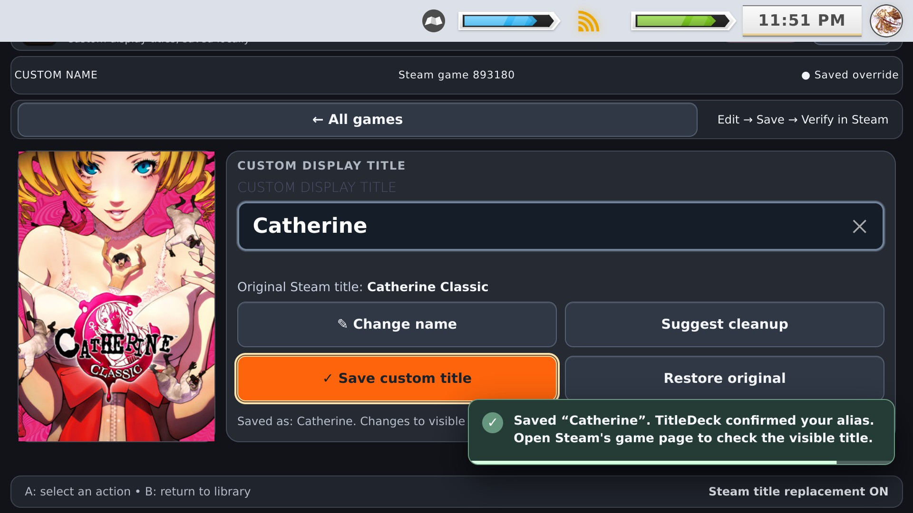
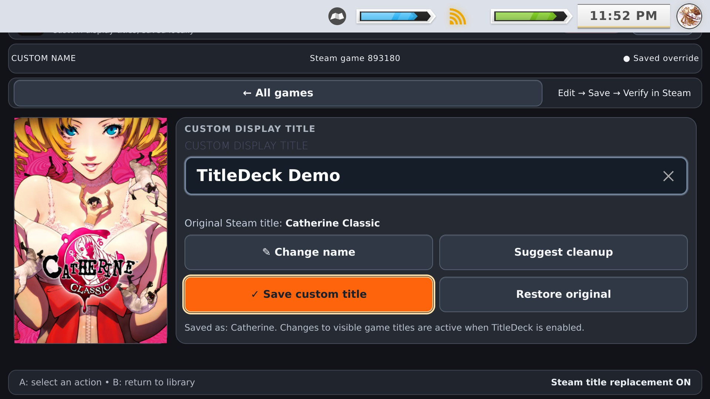

# TitleDeck 0.9.0 RC1: Steam Deck screenshots

**Eight real Steam Deck Gaming Mode captures showing the public 0.9.0 RC1 interface.** Images are copied byte-for-byte from the maintainer's uploaded screenshot ZIP, without modification or recompression.

**Version clarification:** The originally uploaded screenshot asset was mistakenly titled **0.9.1**, but these screens show **TitleDeck 0.9.0 RC1**. The installer is still `0.9.0-rc.1`, published under GitHub tag `0.9.0`. There is no 0.9.1 release implied by these photos.

> **Compatibility:** These captures come from a physical Steam Deck running Gaming Mode, with a customized Steam/CSS Loader visual theme. Other hardware, including ROG Ally, alternative SteamOS-like systems, Windows, Android/DroidDeck and Desktop Mode, is unverified.

[Back to TitleDeck](../README.md) · [Download 0.9.0 RC1](https://github.com/ValentineBSAA/TitleDeck/releases/tag/0.9.0)

## Current release: 0.9.0 RC1 (8 screenshots)

| Quick Access | Full library |
|:---:|:---:|
|  |  |
| **01. Decky menu** | **02. Library manager** |
|  |  |
| **03. Catherine editor** | **04. Native Steam keyboard** |
|  |  |
| **05. Cleanup feedback** | **06. Save confirmation** |
|  |  |
| **07. Unsaved name draft** | **08. Updated name in Steam** |

## What each image demonstrates

1. **Quick Access menu:** TitleDeck appears in Decky Quick Access, displaying the version and library-manager action.
2. **Full Library Manager:** Browsable game artwork, filters, search and controller-focused cards.
3. **Custom title editor:** Catherine Classic with a saved display alias of Catherine and four editing actions.
4. **Native Steam keyboard:** Change Name opens Steam's keyboard while the editable field remains visible.
5. **Cleanup feedback:** Suggest Cleanup reports no change needed when the current draft is already clean.
6. **Explicit save confirmation:** TitleDeck displays the saved-alias confirmation after saving Catherine.
7. **Edited title draft:** The draft says TitleDeck Demo while the last saved alias still reads Catherine.
8. **Name displayed in Steam:** Steam's game library displays the replacement title TitleDeck Demo.

**Important details:** Screenshot 05 shows a *no-cleanup-needed* response, **not** the full before-and-after cleanup preview. Screenshot 07 shows an **unsaved draft**; the previously saved alias is still shown beneath it. Screenshot 08 shows the actual display name in Steam.

The release still has a known intermittent behavior where pressing B closes Steam's keyboard but the editor may remain raised. Use **Done editing** as the fallback. The screenshots do not establish that this issue is fixed.

## Earlier release: v0.8.1 (7 preserved screenshots)

These older Steam Deck screenshots remain for comparison. They are **not** labeled as 0.9.0 RC1 images.

| v0.8.1 capture | v0.8.1 capture |
|:---:|:---:|
|  |  |
|  |  |
|  |  |
|  | |

All eight current images and seven historical captures are directly viewable in the repository. The screenshot ZIP on the release is an optional gallery download, **not** the plugin installer.
