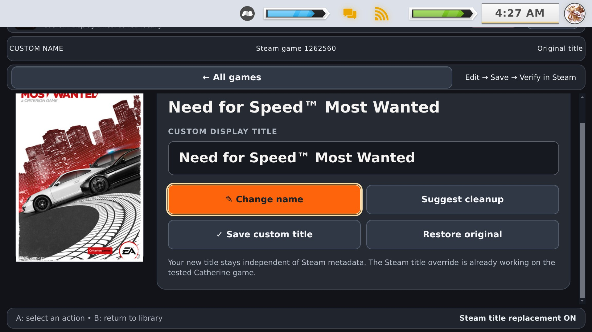
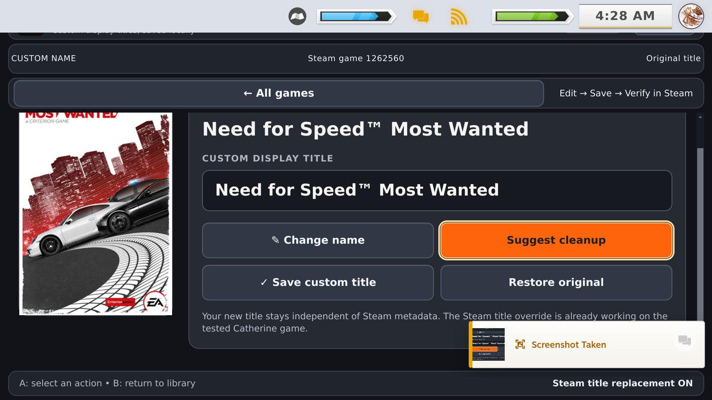
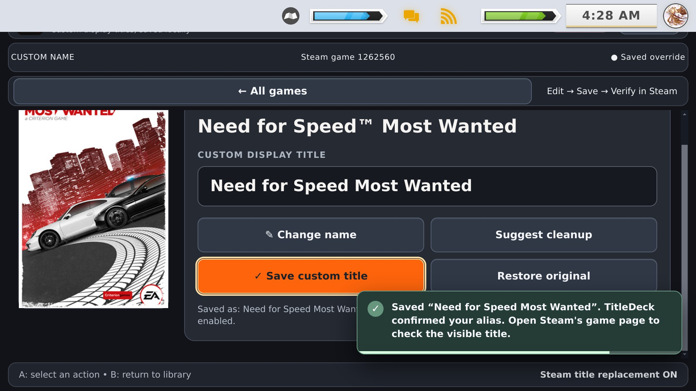
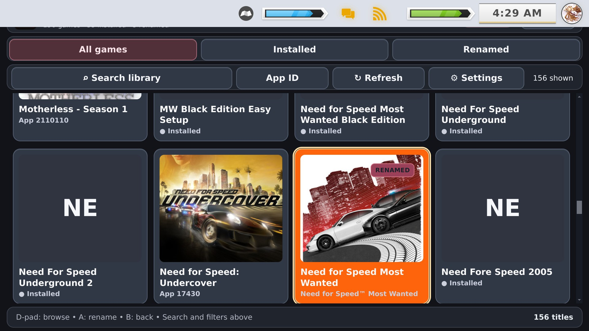
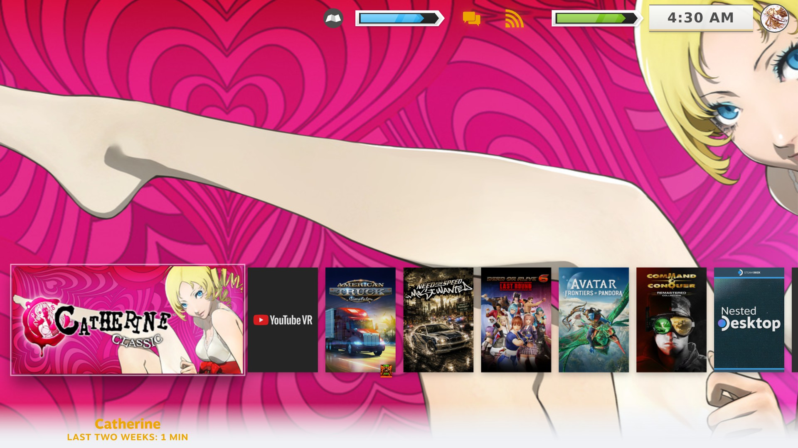

# TitleDeck on Steam Deck

Actual Gaming Mode screenshots supplied with the official 0.8.1 prerelease.

> Screens may include a custom CSS Loader theme. Artwork and presentation vary by Steam configuration.

[Back to TitleDeck](../README.md)

**7 screenshots** · [v0.8.1 release](https://github.com/ValentineBSAA/TitleDeck/releases/tag/0.8.1)

### Steam Deck screenshot 01

### Steam Deck screenshot 02

### Steam Deck screenshot 03

### Steam Deck screenshot 04

### Steam Deck screenshot 05

### Steam Deck screenshot 06

### Steam Deck screenshot 07

