# TitleDeck 1.1.8 screenshot gallery

**23 real Steam Deck Gaming Mode screenshots**, organized by what a user is trying to do. These are individual images checked into the repository, not a screenshot archive or an installer.

[← Back to README](../README.md) · [Beginner guide](BEGINNER_GUIDE.md) · [1.1.8 release](https://github.com/ValentineBSAA/TitleDeck/releases/tag/1.1.8)

> [!NOTE]
> **1.2.1 Beta screenshots are not yet committed in this gallery.** The 23 images below are authentic **1.1.8** captures, not representations of the new native game Options shortcut, STEAM-button menu aliases or the 650 ms hold. The maintainer has visually verified Catherine and non-Steam Most Wanted in those newer surfaces, but new images should be uploaded and reviewed before labeling a 1.2.1 gallery complete. [Beta notes](RELEASE_NOTES_1.2.1_BETA.md).

## 1. Start here: Quick Access and Full Library Manager

| Quick Access: open TitleDeck | Full Library Manager: browse games |
|:---:|:---:|
|  |  |
| **Open Full Library Manager** from Decky's TitleDeck panel. | Filter **All games / Installed / Renamed**; browse with D-pad and LB/RB. |

## 2. The main feature: custom Steam and non-Steam Game Info

| **Steam game**: Catherine Classic | **Non-Steam game**: Need for Speed Most Wanted 2005 |
|:---:|:---:|
|  |  |
| Custom Steam Game Info description beside Community. | Imported PC game with artwork at left and description at right. |

| Catherine Classic: lower Game Info area | Most Wanted 2005: end of description, Proton details |
|:---:|:---:|
| [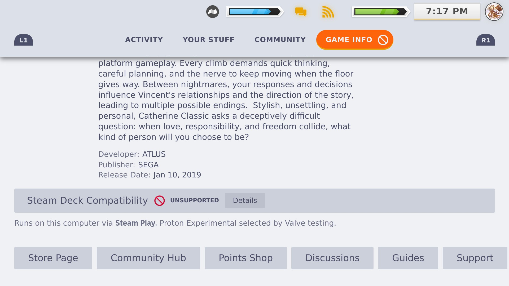](screenshots/v1.1.8/11-steam-catherine-game-info-bottom.jpeg) | [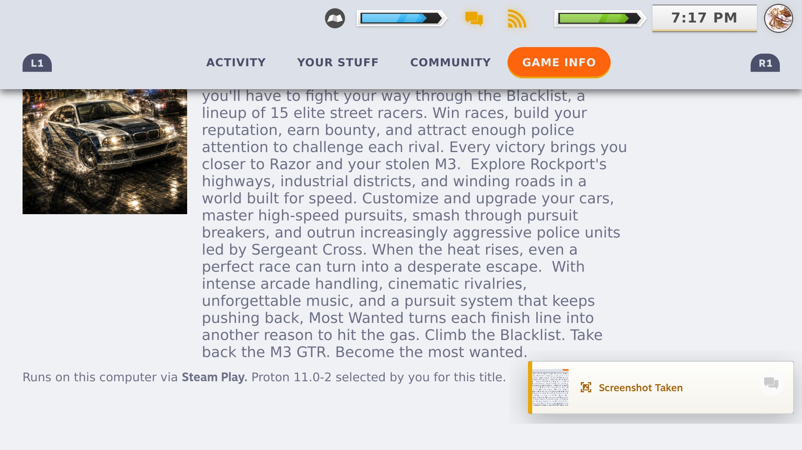](screenshots/v1.1.8/14-nonsteam-most-wanted-description-bottom.jpeg) |

[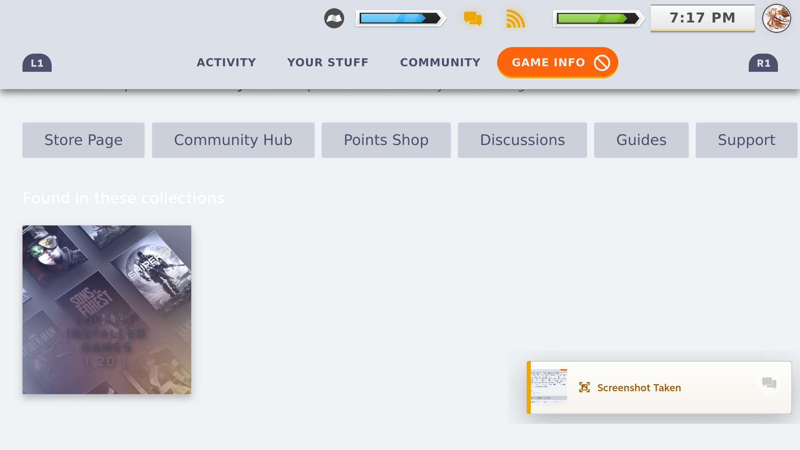](screenshots/v1.1.8/12-steam-catherine-artwork-view.jpeg)

> **Note:** Steam and non-Steam description text **displays and persists after restart** in 1.1.8. A known right-stick scrolling problem affects the **Game Info description area** on both types. This screenshot gallery is not proof that right-stick scrolling works there. [Issue #8](https://github.com/ValentineBSAA/TitleDeck/issues/8).

## 3. Rename, edit and save

| Rename a game | Editing a game description |
|:---:|:---:|
| [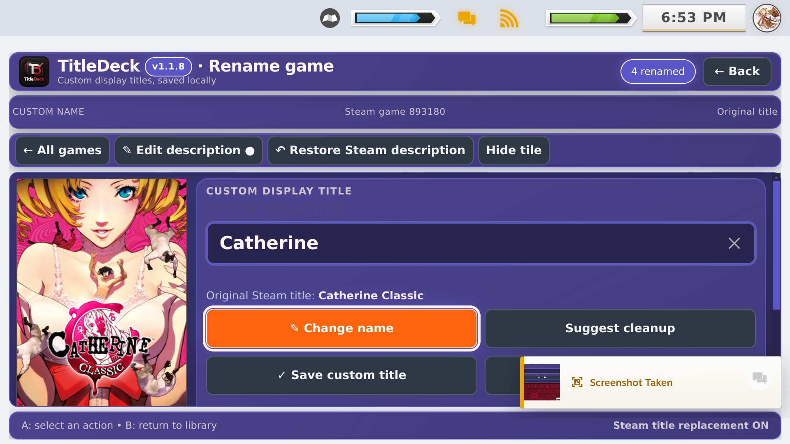](screenshots/v1.1.8/05-rename-game-actions.jpeg) | [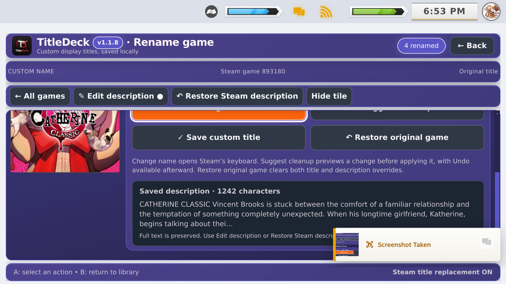](screenshots/v1.1.8/04-description-editor-overview.jpeg) |
| Choose **Change name**, **Suggest cleanup**, then **Save custom title**. | Open the description editor and explicitly save your custom text. |

| Editing a display title | More description controls |
|:---:|:---:|
| [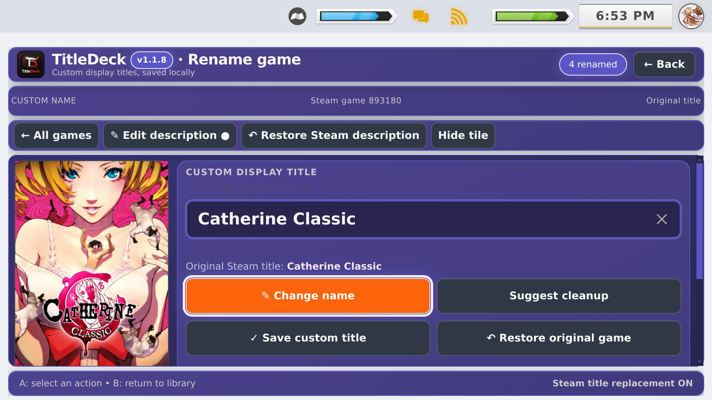](screenshots/v1.1.8/03-title-editor-overview.jpeg) | [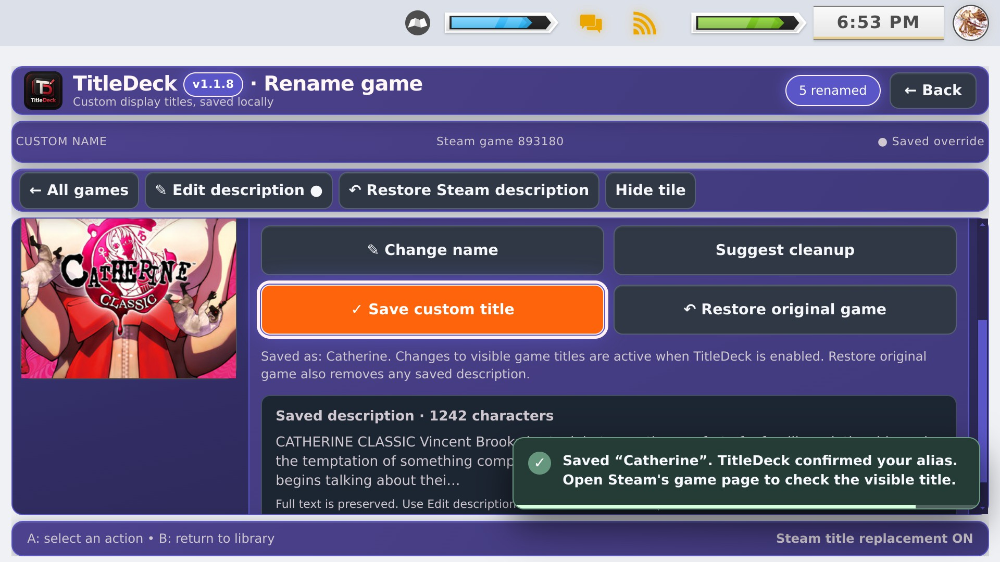](screenshots/v1.1.8/06-description-editor-details.jpeg) |

[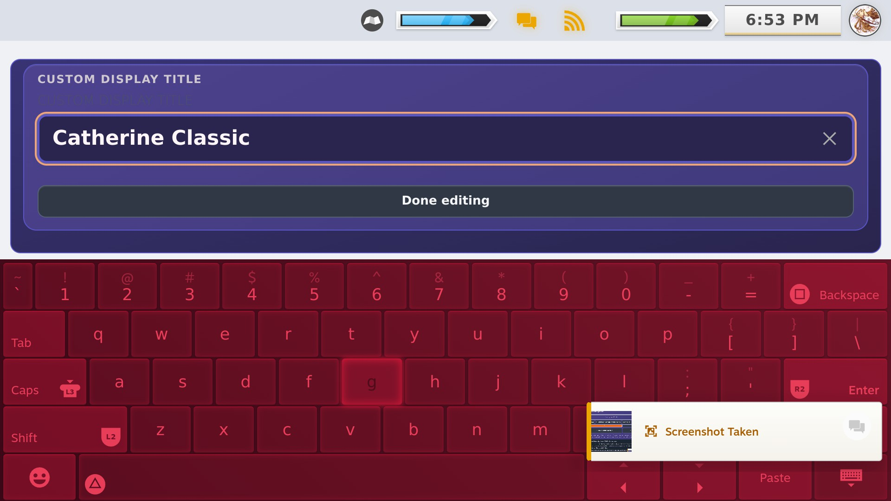](screenshots/v1.1.8/07-native-steam-keyboard.jpeg)

## 4. Find games and App IDs

| Search by title or ID | Keyboard input for an App ID |
|:---:|:---:|
|  | [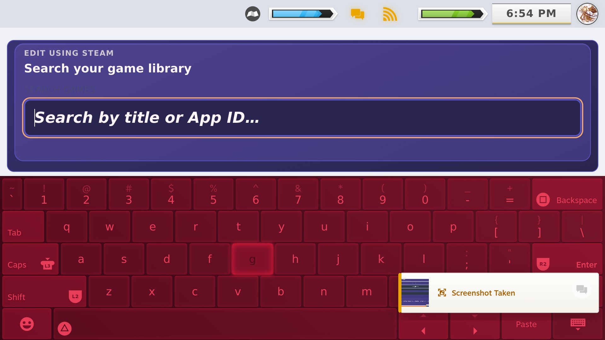](screenshots/v1.1.8/09-search-app-id-keyboard.jpeg) |

## 5. All nine Settings screens

These images show real settings from TitleDeck 1.1.8. The names match the implementation.

| Display title replacement | Save / restore backup | Recover / hidden entries |
|:---:|:---:|:---:|
| [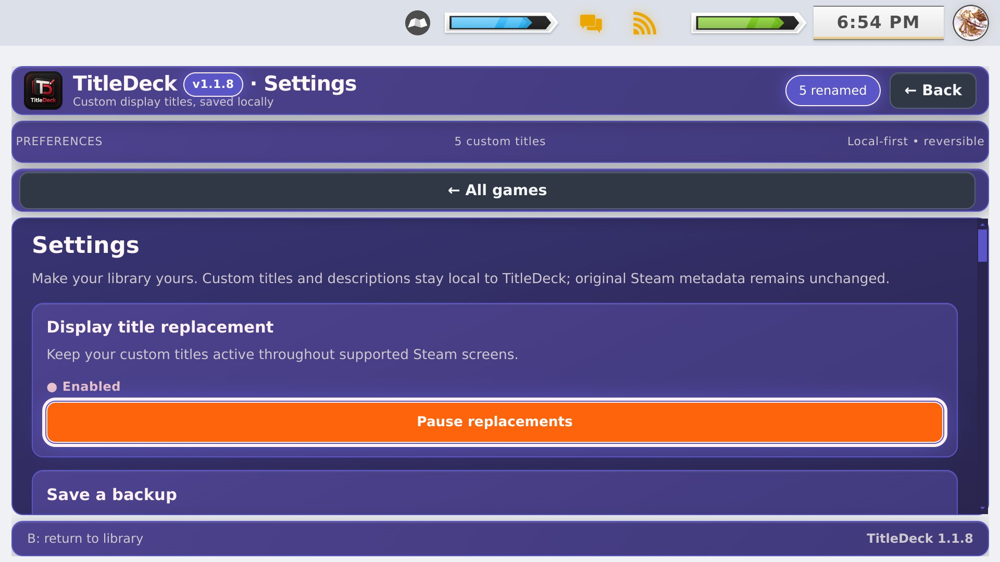](screenshots/v1.1.8/15-settings-title-replacements.jpeg) | [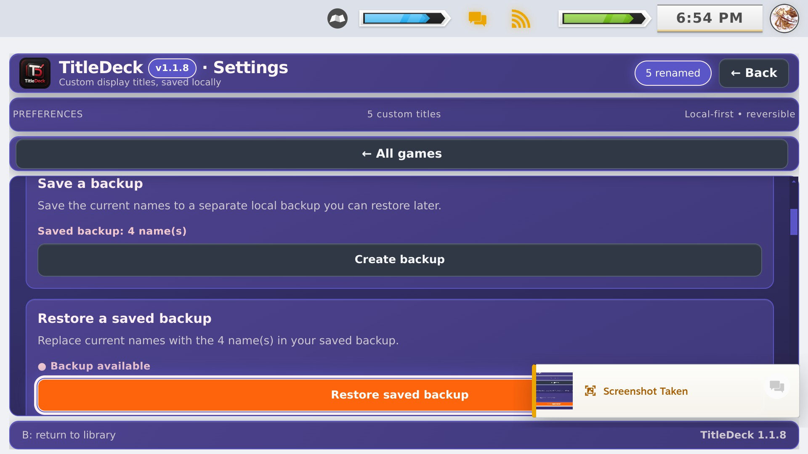](screenshots/v1.1.8/16-settings-backup-restore.jpeg) | [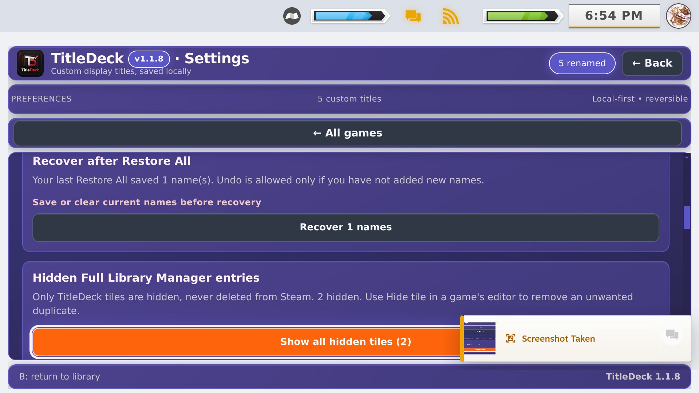](screenshots/v1.1.8/17-settings-recovery-hidden-tiles.jpeg) |

| Description placement | Complete theme accents | Right-stick toggle |
|:---:|:---:|:---:|
| [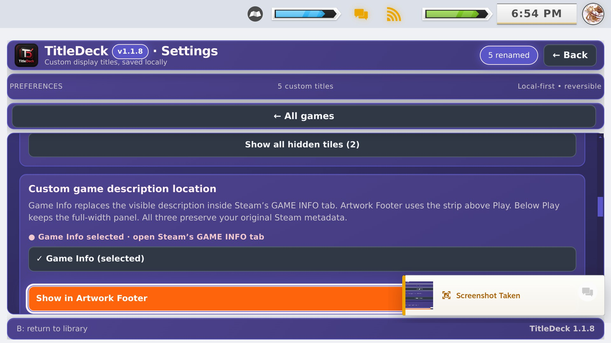](screenshots/v1.1.8/18-settings-description-placement.jpeg) | [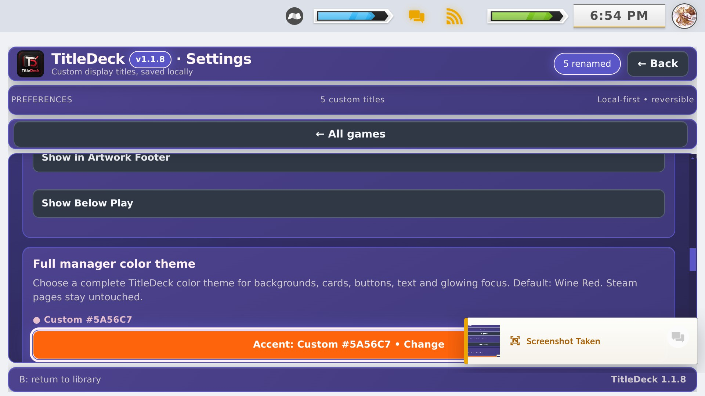](screenshots/v1.1.8/19-settings-theme-accent.jpeg) | [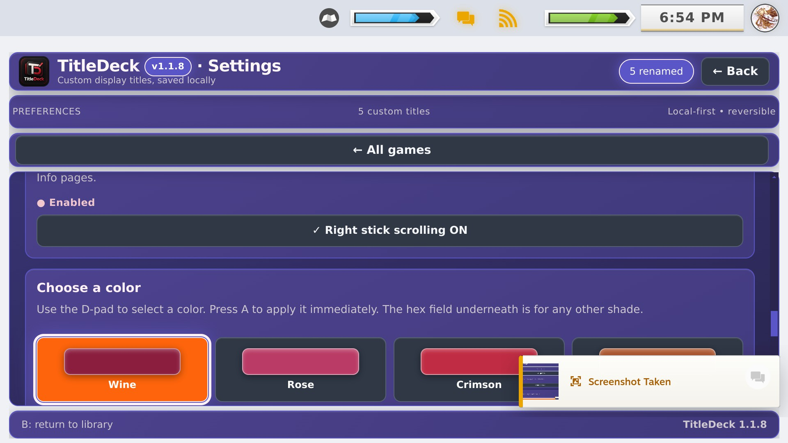](screenshots/v1.1.8/20-settings-right-stick-toggle.jpeg) |

| Preset colors | Custom HEX / visual color picker | Restore All confirmation entry |
|:---:|:---:|:---:|
| [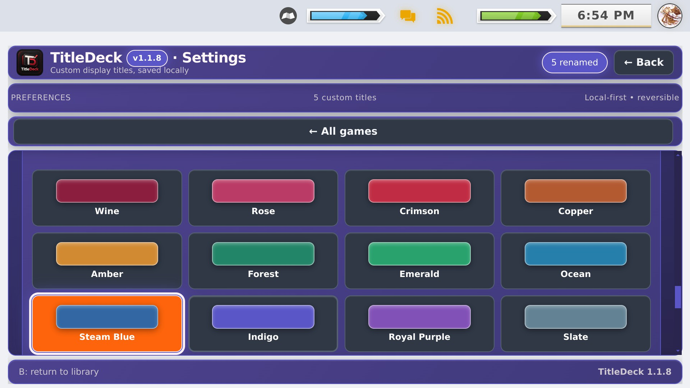](screenshots/v1.1.8/21-settings-color-presets.jpeg) | [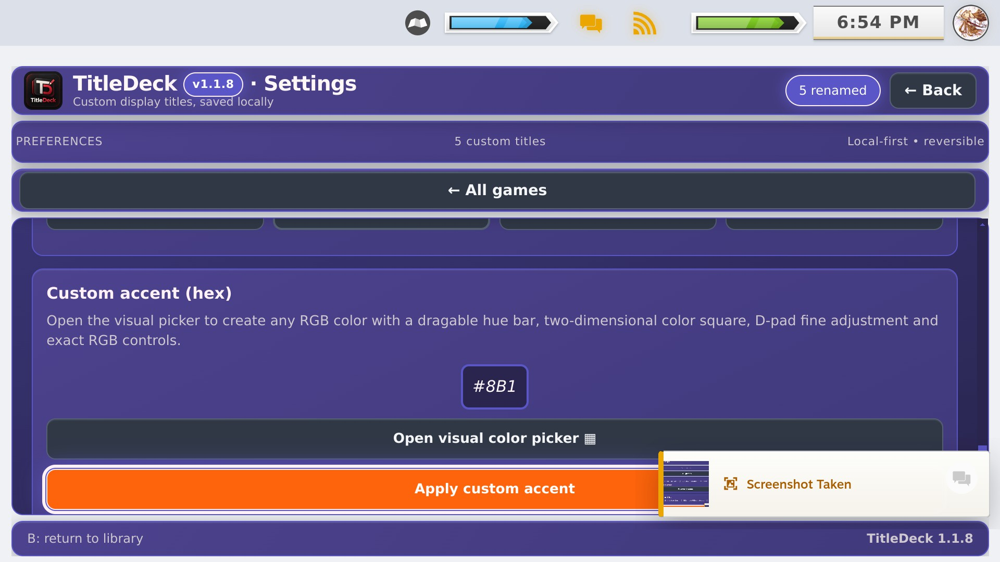](screenshots/v1.1.8/22-settings-custom-hex.jpeg) | [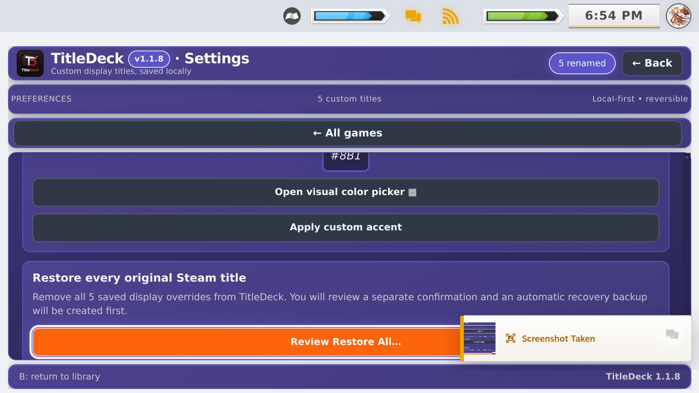](screenshots/v1.1.8/23-settings-restore-all.jpeg) |

### Screenshot provenance

The source archive was **TitleDeck.1.1.8.screenshots.zip** attached by the maintainer to the public 1.1.8 release. These are **23 individually extracted images**, preserving the original captures. Archive SHA-256: `44fe0ed371c71ff241c0a30178320c9045e8c77eed10bda0f6a4bae92454eced`. Mac-specific `__MACOSX` metadata entries were excluded. The image gallery can be browsed without downloading a ZIP.

## Historical screenshot archive

For the development record, these captures are **older builds** and must not be mistaken for 1.1.8 screenshots.

| 0.9.2 Beta 1 Quick Access | 0.9.2 Beta 1 custom Game Info | 0.9.2 Beta 1 long text |
|:---:|:---:|:---:|
|  |  |  |

Earlier 0.9.0 RC1 and 0.8.1 screenshots also remain preserved in their original versioned folders. The 0.9.2 builds had a documented Game Info bug subsequently addressed in 1.1.8; older images are historical evidence, not a promise about those older packages.
